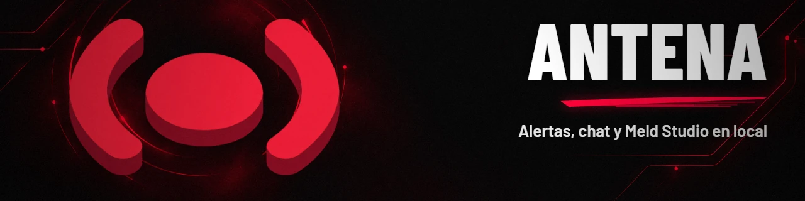
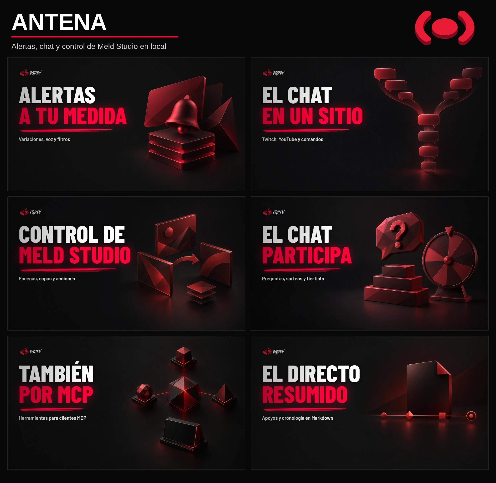

<!-- egdev:lang:start -->
<p align="right">
  <a href="./README.md"></a>
  
</p>
<!-- egdev:lang:end -->

<!-- egdev:header:start -->


<div align="center">

[](https://github.com/egdev6/antena/milestone/4)
[](https://github.com/egdev6/antena/blob/main/package.json)
[](https://github.com/egdev6/antena/stargazers)
[](https://github.com/egdev6/antena/issues)
[](./LICENSE)

</div>
<!-- egdev:header:end -->

# antena

Alertas, chat y widgets de directo para **Meld Studio**, en local, gratis y con la identidad EGDEV. Es una **app de escritorio** (Tauri + React) que se controla desde su panel, desde el **Stream Deck**, desde el **panel de chat de Meld** y **también desde un servidor MCP**, para que Claude (o cualquier cliente MCP) pueda ver y cambiar absolutamente todo.

## Qué es

antena se queda entera en tu PC y le da a tu directo una capa completa de alertas e interacción:

- **Alertas** de Twitch (seguidores, subs, resubs, subs regaladas, bits y Power-ups, raids, recompensas) y YouTube (suscriptores nuevos, Super Chats, Super Stickers, miembros, hitos y membresías regaladas). Tabla evento → alerta: [docs/eventos.md](docs/eventos.md).
- **Tres diseños por alerta:** la tarjeta 3D EGDEV; tu vídeo o imagen (webm con transparencia) con el mensaje encima, colocado donde quieras; o **vídeo + tarjeta**: tu vídeo o imagen de fondo a pantalla completa y encima la tarjeta 3D, con retraso de entrada y ajuste de posición. Todos con CSS propio.
- **Variaciones:** otra versión de la alerta según la cantidad, el tier, el usuario, el mensaje o una probabilidad.
- **Voz (TTS)** de los mensajes, **filtro** de palabras, enlaces y usuarios, y **pausa** con cola.
- **Acciones en Meld** al salir una alerta: cambiar de escena (y volver), mostrar u ocultar capas, efectos, confeti, ruleta, guardar clip, escribir en el chat, hablar…
- **Comandos de chat** (`!engram`, `!web`…) que lanzan sus propias alertas, con permisos y esperas.
- **Mensajes programados:** textos que se publican solos en el chat cada X minutos (también como anuncio destacado) y, si quieres, salen además como alerta en pantalla.
- **Interactivos:** cola de preguntas del chat, tier list que vota el chat y sorteos con ruleta en pantalla.
- **Widgets:** chat en pantalla (Twitch + YouTube), objetivos, últimos apoyos, ticker, espectadores en directo, agradecimientos a seguidores sin conexión y créditos finales.
- **Overlays propios:** capas de HTML, CSS y JavaScript para una escena o para enmarcar la cámara, escritas por ti o por Claude por MCP, con datos en vivo y acciones que apruebas tú.
- **Resumen del directo:** totales, a quién dar las gracias y la cronología con el minuto de cada evento, en Markdown.
- **Seguidores sin conexión:** registra los seguidores de Twitch ganados mientras antena estaba cerrada y, en YouTube, las suscripciones públicas y un recuento anónimo; YouTube requiere conectar la cuenta.
- **Panel desde el móvil** en la red local, protegido con clave.
- **Fuentes para Meld:** cada alerta, widget, panel y overlay propio es una fuente de navegador con su tamaño, listas para copiar.
- **Prompter para el Elgato Prompter** (1024×600): la app lo abre a pantalla completa en esa pantalla.
- **Alerta de récord de espectadores** por plataforma (Twitch y YouTube), con freno anti-spam.
- **Apariencia:** un solo tema para todo lo que sale en pantalla (alertas, widgets y créditos): colores, fuentes (también las tuyas), iconos por alerta, forma, posición, animación y sonido. El de serie es el de EGDEV.
- **Atajos para Stream Deck** personalizables: cada uno encadena pasos (marca, pausa, escena, capa, chat, pestaña del prompter…) y tiene su dirección `/sd/custom/<id>`.
- **Dock para Meld:** todo el manejo del directo menos la vista previa —escenas, pistas de audio de Meld, alertas, preguntas, votación, sorteo, teleprompter y créditos— y adaptable: tres columnas desde 1024 px de ancho, sin importar la orientación; por debajo, una pestaña por sección.

El servidor no tiene dependencias (Node ≥ 24). La interfaz es React compilada con esbuild y la app de escritorio es Tauri 2, que arranca ese servidor como *sidecar*. Todo se queda en tu PC.

<p align="center"></p>

<!-- egdev:stack:start -->
<div align="center">
<a href="https://github.com/Gentleman-Programming/gentle-ai">
  
</a>
</div>

<div align="center">


</div>
<!-- egdev:stack:end -->

## Inicio rápido

### Instalador de Windows

Descarga el instalador `antena_<versión>_x64-setup.exe` de la [última release](https://github.com/egdev6/antena/releases/latest) (notas en [`docs/releases/`](docs/releases/)) y ábrelo; se instala para tu usuario. El instalador **no está firmado con un certificado de Windows**: SmartScreen avisa de «editor desconocido» y hay que pulsar **Más información › Ejecutar de todas formas**.

**Actualizaciones:** desde la 0.10.0, **Ajustes › Acerca de** busca e instala las versiones nuevas, firmadas, sin descargar nada a mano. Si vienes de la 0.9.0, instala la 0.10.0 a mano una vez. Tus datos se conservan.

El mantenedor genera ese instalador desde **Actions › Release** (workflow manual, solo desde `main`, con la versión de `package.json`): compila en Windows y crea un **borrador** de release con el `.exe` y las notas de `docs/releases/v<versión>.md`, que se revisa y se publica a mano.

### App de escritorio (Windows), desde el código

Hace falta, una vez: [Rust](https://rustup.rs) (toolchain MSVC), WebView2 (viene con Windows 11), Node 24 y pnpm (`corepack enable` instala la versión fijada en `package.json`).

```powershell
cd ruta\a\antena
pnpm install         # React, esbuild y la CLI de Tauri (solo para compilar)
pnpm fonts           # Barlow y JetBrains Mono en public/fonts (el overlay no depende de internet)
pnpm desktop:node    # copia tu Node a src-tauri/binaries (el servidor que va dentro de la app)
pnpm desktop:dev     # app en modo desarrollo (usa el código de src/ directamente)
pnpm desktop:build   # instalador en src-tauri/target/release/bundle/nsis
```

La app arranca el servidor en `http://127.0.0.1:4500`, abre el panel y deja un icono en la bandeja. **Cerrar la ventana la deja en la bandeja**: las fuentes de Meld y el Stream Deck siguen funcionando. Para apagarlo todo, «Salir» en el menú de la bandeja (guarda y cierra el servidor con orden).

- Los datos de la app instalada van en `%APPDATA%\es.egdev.antena\data` y `…\media`. Para seguir usando los de la carpeta del proyecto, copia `data/` y `media/` allí, o arranca con `ANTENA_DATA` y `ANTENA_MEDIA` apuntando a ellas. En `desktop:dev` se usan los del proyecto.
- Si ya hay un antena escuchando en el puerto con la misma carpeta de datos, la app lo reutiliza. En otro caso no se conecta y te pide que cierres el servidor que ocupa el puerto. Cada carpeta de datos tiene una identidad aleatoria ligada a su ruta real en `instance.json`; una copia recibe otra identidad y la API de estado no expone la ruta.
- Otro puerto: `"port"` en el `config.json` de la carpeta de datos que se use, o la variable `ANTENA_PORT`.

### Solo el servidor (sin app)

```powershell
pnpm install     # una vez: esbuild y React para compilar la interfaz
pnpm app:build   # compila la interfaz React en app/dist
pnpm start
```

Panel: http://127.0.0.1:4500/ · prompter: `/prompter` · dock: `/dock`. Sin `app/dist`, el servidor responde una página mínima que explica cómo compilar la interfaz (`pnpm app:build`) en lugar del panel. Para trabajar en la interfaz: `pnpm app:dev` (recompila al guardar) con `pnpm start` en otra terminal.

## Scripts

| Script | Qué hace |
|---|---|
| `pnpm start` | Arranca el servidor (`src/server.mjs`) |
| `pnpm app:build` | Compila la interfaz React en `app/dist` (esbuild) |
| `pnpm app:dev` | Recompila la interfaz al guardar |
| `pnpm desktop:dev` | App de escritorio en modo desarrollo (Tauri) |
| `pnpm desktop:build` | Genera el instalador de Windows (NSIS) |
| `pnpm desktop:node` | Copia tu Node a `src-tauri/binaries` (sidecar) |
| `pnpm fonts` | Descarga Barlow y JetBrains Mono en `public/fonts` |
| `pnpm test` | Ejecuta los tests (`node --test`) |
| `pnpm baseline` | Ejecuta las comprobaciones baseline |
| `pnpm typecheck` | Comprobación de TypeScript de `app/` |
| `pnpm mcp` | Arranca el servidor MCP (stdio) |

## Guía de uso

### Capas de navegador en Meld

En el panel, **Meld y Stream Deck › Fuentes para Meld** lista todas con su tamaño y un botón de copiar (incluye un objetivo por cada uno que tengas). En Meld: **+ › Browser**, pega la dirección y pon ese ancho y alto. Meld no deja crear capas desde fuera, así que se añaden a mano una vez.

| Capa | URL | Tamaño |
|---|---|---|
| Alertas | `http://127.0.0.1:4500/overlay` | 1920×1080, con **Add audio track** |
| Chat | `http://127.0.0.1:4500/widget/chat` | 600×900 |
| Objetivo | `http://127.0.0.1:4500/widget/goal?id=principal` | 1000×200 |
| Últimos | `http://127.0.0.1:4500/widget/latest` | 1400×200 |
| Ticker | `http://127.0.0.1:4500/widget/ticker` | 1920×64 |
| Créditos | `http://127.0.0.1:4500/widget/credits` | 1920×1080 |
| Pregunta | `http://127.0.0.1:4500/widget/question` | 1920×1080 |
| Tier list | `http://127.0.0.1:4500/widget/tierlist` | 1920×1080 |
| Sorteo | `http://127.0.0.1:4500/widget/giveaway` | 1920×1080 |
| Espectadores | `http://127.0.0.1:4500/widget/viewers` | 900×160 |
| Agradecimientos | `http://127.0.0.1:4500/widget/thanks` | 900×200 |

**Agradecimientos sin conexión.** Esta capa muestra un seguidor pendiente cada vez y puede terminar con el recuento anónimo de YouTube. En Widgets › Agradecimientos eliges plataformas, todo el tiempo / desde el último directo archivado / un número de días, máximo de nombres e intervalo. Las fechas desconocidas se incluyen; si no hay directos archivados, la ventana desde el último no tiene corte. Sin pendientes la capa queda transparente. Las acciones individuales y en bloque con confirmación se aplican al momento; el bloque marca solo los nombres y registros anónimos seleccionados con los ajustes guardados, no los demás pendientes.

**Barras de objetivo.** Los seguidores y subs de Twitch y los suscriptores de YouTube muestran el total del canal que informa la plataforma, no solo los eventos del directo, y no se reinician entre directos. Antena lo consulta al arrancar, al reconectar y cada cinco minutos; los eventos en vivo suman entre lecturas. Si hay un canal de YouTube configurado, los suscriptores detectados solo suman cuando coincide con el ID del canal de la cuenta conectada; si es distinto o no se puede comprobar, el total se actualiza en la siguiente lectura de la plataforma. Si la plataforma no responde, se conserva el último valor conocido; antes de la primera lectura la barra muestra `—`. +1, −1 y «Fijar» aplican una corrección persistente (por ejemplo, para descontar tu propia sub). Las subs de Twitch requieren el permiso `channel:read:subscriptions`. YouTube redondea los suscriptores a tres cifras significativas a partir de 1.000. Las demás métricas de objetivo siguen siendo por directo.

**Variantes del chat (API del servidor).** `POST /api/widgets/chat/variants` con `{ "name": "Directo" }` crea una copia con nombre de todos los ajustes actuales del chat predeterminado. Los cambios posteriores del predeterminado no se propagan. Los campos explícitos al crear deben coincidir con la copia predeterminada; si son distintos se rechazan. `GET` en esa ruta lista las variantes; `PUT` o `DELETE` en `/:id` editan o borran una. Se validan nombres y ajustes, cambiar el id al renombrar se rechaza y el predeterminado no se puede borrar. La validación se aplica cuando se incluye o se apunta explícitamente a `chatVariants`; las demás escrituras conservan su comportamiento de fusión, reemplazo y `null`. El servidor lista `/widget/chat?variant=<id>` en fuentes y MCP; `/widget/chat` sigue siendo la URL predeterminada sin cambios. El widget selecciona el id exacto de la variante y usa el predeterminado si falta, es desconocido o se ha borrado. Cada configuración independiente tiene `layout: "vertical" | "horizontal"` (por defecto `vertical`): la fila horizontal coloca los mensajes nuevos a la derecha y desvanece los antiguos en el borde izquierdo; `reverse` invierte el orden y las animaciones direccionales. El ancho disponible y `maxMessages` limitan la fila y los mensajes se recortan a dos líneas. En capas horizontales de poca altura se adaptan el espacio vertical y la altura de las tarjetas; las fuentes configuradas también se reducen cuando hace falta. En **Widgets › Chat en pantalla**, crea una variante a partir del predeterminado guardado, elige su disposición y ajustes, y pulsa **Guardar**. Copia la URL de la variante seleccionada en su fuente de navegador de Meld; renombrarla no cambia la dirección. El panel sugiere 600×900 para el chat vertical y 1832×160 para el horizontal; ajústalos a tu escena. Guarda o descarta el borrador antes de cambiar o gestionar variantes. El chat no admite un parámetro `?layout=` independiente.

Parámetros del overlay: `?pos=top|center|bottom`, `&scale=0.8`, `&mute`, `&debug`. Créditos: `?transparent`, `?autoplay`, `?loop`. Últimos: `?layout=column`, `?items=follow,sub`. Espectadores: `?platforms=twitch`, `?layout=column`, `?total=0`, `?peak=1`.

Los **overlays propios** salen en esa misma lista como «Overlay · nombre», con su URL `/custom/<id>` y su tamaño.

### Meld Studio

1. En Meld: **Ajustes › Avanzado › Allow remote connections**.
2. En el panel: **Meld Studio › Conectar** (por defecto `ws://127.0.0.1:13376`).

Desde ahí ves las escenas, capas y pistas, cambias de escena con un clic, muestras u ocultas capas y lanzas atajos (clip, captura, confeti, ruleta, grabar). Cada pista muestra además su **volumen actual**, en directo con lo que muevas en Meld. Al empezar a emitir, el panel empieza un directo nuevo él solo (se puede desactivar).

En cada alerta, variación o comando, **Acciones al salir** se ejecuta justo cuando la alerta aparece en pantalla:

| Acción | Qué hace |
|---|---|
| Cambiar a escena | Pone una escena en directo y, si quieres, vuelve a la anterior tras X segundos |
| Mostrar capa unos segundos | Enseña una capa y la oculta después |
| Ocultar / alternar capa, alternar efecto | Lo que dice |
| Comando de Meld | Guardar clip, captura, grabar, emitir, cámara virtual, repetición… |
| Evento de widget de Meld | Confeti, ruleta, contador, cronómetro, cuenta atrás, subathon |
| Escribir en el chat | Escribe en tu chat de Twitch, de YouTube o en los dos (selector «Dónde»; sin elegir, Twitch), con `{user}` y demás variables. Cada plataforma tiene su propio resultado: si una falla, la acción queda como fallida con su motivo, y lo que ya salió en la otra no se repite |
| Decir en voz alta | Lee un texto en el overlay |

Las escenas y capas se indican por nombre, así que puedes prepararlas aunque Meld esté cerrado.

### Variaciones

En cada alerta, **Variaciones › Añadir variación**. Cada una tiene:

- **Condiciones:** cantidad mínima y máxima, tier, usuarios concretos, palabras en el mensaje y probabilidad.
- **Cambios:** solo lo que quieras distinto (otro vídeo, sonido, texto, acciones…). Lo demás se hereda de la alerta; el botón ↺ vuelve a heredar un campo.

Si varias encajan, gana la primera; el orden se cambia con ↑ ↓.

### CSS personalizado

Cada alerta, variación, comando y mensaje programado tiene su pestaña **CSS propio** debajo de la preview. La pestaña **CSS común** se aplica a todas las alertas. Los estilos de serie van en una capa (`@layer egdev`), así que tu CSS siempre gana sin `!important`. Se guarda y se ve en la preview al momento.

La forma más fácil son las variables:

```css
.alert { --accent: #00E0FF; --tilt: none; --name-size: 70px; }
.alert-name { color: #FFD400; }
.card { border-radius: 8px; }
```

| Variable | Qué cambia |
|---|---|
| `--accent` | Color principal: brillos, borde, barra de tiempo y título salen de él |
| `--title-color`, `--name-color`, `--sub-color`, `--hl-color` | Colores del texto |
| `--title-size`, `--name-size`, `--sub-size` | Tamaños de letra (el nombre se ajusta solo si no cabe) |
| `--font-title`, `--font-name`, `--font-sub` | Tipografías |
| `--card-width`, `--card-radius`, `--card-padding`, `--card-bg` | Tarjeta |
| `--border-width`, `--border-color` | Borde |
| `--tile-size`, `--tile-radius`, `--icon-size`, `--icon-color` | Icono |
| `--tilt`, `--reflection` | Inclinación 3D y reflejo (`none` para quitarlos) |
| `--text-x`, `--text-y`, `--text-w`, `--text-align`, `--media-w` | Posición del texto sobre tu vídeo |
| `--ink`, `--fs` | Color y tamaño del texto en alertas con vídeo |

Clases: `.alert`, `.card`, `.alert-title`, `.alert-name`, `.alert-sub`, `.alert-icon`, `.alert-platform`, `.alert-glow`, `.alert-dots`, `.alert-cube`, `.alert-timer`, `.alert-media` y `.type-follow`, `.type-raid`… para afinar por tipo desde el CSS común.

Los botones de **fragmentos** insertan recetas listas: otro color, sin inclinación, más pequeña, sin decoración, sin reflejo, sin plataforma, sin icono, fondo de cristal, texto con contorno y latido al entrar. Los widgets también tienen su campo CSS y funcionan igual.

### Overlays propios

Una capa nueva para Meld hecha con HTML, CSS y JavaScript: un marco para la cámara, un título animado, un cartel para una escena. Los escribes tú en **Overlays** o se los pides a Claude por MCP (`crear_overlay`); lo que hace el agente aparece en el panel sin recargar.

| Dónde | Qué hay |
|---|---|
| Panel › **Overlays** | Lista en tarjetas, editor con pestañas HTML, CSS y JavaScript, vista previa en vivo, ancho y alto, fondo transparente, permisos, copiar URL y borrar |
| Meld | Capa **+ › Browser** con `http://127.0.0.1:4500/custom/<id>` y el tamaño del overlay (también está en **Fuentes para Meld**, como «Overlay · nombre») |
| Al guardar | Todas las capas abiertas (Meld y la vista previa) se recargan solas: no hay que tocar la fuente en Meld |

`/theme.css` ya viene enlazado: usa sus variables (`var(--accent)`, `var(--text)`…) para que combine. El fondo es transparente por defecto, así que queda bien encima de la cámara, y los recursos externos por https (fuentes, imágenes) sí cargan. Ancho 16–7680, alto 16–4320, hasta 50 overlays y 512 KB de JSON por overlay.

#### El SDK: datos en vivo y acciones

`window.antena` es lo único que hay en la página:

| API | Qué hace |
|---|---|
| `antena.on(evento, fn)` | Escucha un evento y devuelve la función para dejar de escuchar. Si ya hay un valor, `fn` se llama al momento con él |
| `antena.state` | Último valor de cada evento (`alert`, `chat`, `viewers`, `widgets`, `interactive`, `theme`); empiezan en `null` |
| `antena.ready` | Promesa que se resuelve cuando ya hay datos: espera antes de leer `antena.state` |
| `antena.run(tipo, params)` | Pide una acción aprobada: resuelve si se ejecutó y se rechaza con el error del servidor si no |

```js
const quien = document.querySelector('.quien');
antena.on('alert', a => {
  quien.textContent = a.vars.user;
  quien.animate([{ opacity: 0 }, { opacity: 1 }], 300);
});
antena.ready.then(() => {
  quien.textContent = antena.state.widgets?.latest?.follow?.user || 'EGDEV';
});
document.querySelector('.marco').onclick = () => antena.run('scene', { scene: 'Cámara' }).catch(e => console.warn(e.message));
```

#### Permisos

El agente **pide** permisos al crear o editar; solo tú los **apruebas** en el panel (interruptores de la pestaña Permisos), y solo se pueden aprobar los que el overlay pide. Tipos: `scene`, `layer`, `hideLayer`, `toggleLayer`, `effect`, `command`, `streamEvent`, `chat` y `say`.

- Sin aprobación, `antena.run` se rechaza (403) y no pasa nada.
- Tope de **10 acciones cada 10 segundos** por overlay: por encima, 429 y no se ejecuta.
- Editar el código no retira lo aprobado, pero el panel avisa cuando el código ha cambiado desde que aprobaste.

**Seguridad.** El código corre en un `<iframe sandbox>` con origen opaco, en una página aparte: no tiene la API de antena, no puede leer el panel ni abrir el flujo de eventos. Los datos le llegan solo por mensajes de la página que lo aloja, y lo único que puede pedir de vuelta son las acciones que apruebas.

Por MCP: `listar_overlays`, `ver_overlay`, `crear_overlay`, `editar_overlay`, `borrar_overlay` y `probar_overlay` (manda un evento de ejemplo a una capa abierta).

> «Hazme un overlay propio con el último seguidor en una tarjeta HTML/CSS animada y añádelo a Meld».

### Comandos de chat

**Comandos de chat › Crear comando.** Cada comando es una alerta completa, con su diseño, sonido, voz y acciones, y además:

- **Quién puede usarlo:** todo el mundo, subs y miembros, VIPs, moderadores o solo tú.
- **Esperas:** entre usos y por persona. Los moderadores y tú no tienen espera.
- **Variables:** `{user}` y `{args}`, que es lo que se escribe detrás del comando.

### Mensajes programados

**Chat › Mensajes programados › Nuevo mensaje.** Cada mensaje tiene:

- **Texto** con variables: `{channel}` (tu canal), `{title}` (título del directo), `{uptime}` (tiempo en directo) y `{follows}` (seguidores nuevos hoy).
- **Cada cuántos minutos** y **cuántos mensajes tiene que haber en el chat** desde la última vez. Así no se repite en un chat parado; tus propios mensajes no cuentan.
- **Dónde se publica:** Twitch, YouTube o los dos. Los mensajes que ya tenías siguen saliendo solo en Twitch.
- **Solo mientras emito** (activado de serie): usa el estado de Meld. Si Meld no está conectado no se sabe si emites, así que **no se publica**, ni solo ni con «Enviar ahora».
- **Como anuncio destacado** de Twitch, con color (el del canal, azul, verde, naranja o morado). YouTube no tiene anuncios: con «YouTube» o «los dos», allí sale el mismo texto como mensaje normal.
- **También en pantalla:** además del chat, sale una alerta completa (tarjeta o vídeo, sonido, voz, acciones de Meld…).

Cada 15 s se mira si toca publicar alguno. El panel muestra cuándo sale el siguiente, por qué está esperando (pausa, Meld sin conectar…), el resultado en cada plataforma y el último error, y tiene «Enviar ahora».

**Límites:** 500 caracteres en Twitch y 200 en YouTube. Al guardar, el panel avisa si la plantilla ya no cabe. Al enviar, el texto nunca se corta: si no cabe en una plataforma, no se manda ahí y queda como fallo parcial con el motivo; la otra sí lo recibe. Lo mismo vale para las acciones «Escribir en el chat».

El botón de pausa también detiene los mensajes programados, los automáticos y «Enviar ahora». Al reanudar, cada uno vuelve a contar su intervalo completo: lo que venció en pausa no se recupera.

### Preguntas, tier list y sorteo

Están en **Widgets** y cada uno tiene su capa de navegador. Su estado (preguntas, votos, participantes) se guarda en `data/interactive.json` y sobrevive a un reinicio.

**Preguntas.** El chat escribe `!pregunta ¿…?` (el comando se cambia). En el panel ves la cola: subir o bajar, descartar, añadir preguntas a mano y «Mostrar». «Siguiente pregunta» saca la primera de la cola y marca la anterior como respondida. Límite de preguntas por persona, largo mínimo, quién puede preguntar y confirmación opcional en el chat. Parámetro de la capa: `?nocount`.

**Tier list.** Crea una lista con sus elementos y tiers (S, A, B, C, D por defecto, con nombre y color editables). Colocas cada elemento con un clic o abres la votación con «Votar en el chat»: el chat escribe la letra (`S`, `A`…) o `!tier S`, se ve en directo cuántos votos lleva cada tier y, al cerrar, el elemento va al más votado (si empatan, al tier más alto). Cada persona tiene un voto por elemento y puede cambiarlo. La votación se puede cerrar sola tras X segundos. Puedes tener varias listas y elegir cuál sale en pantalla. Parámetros de la capa: `?id=<lista>`, `?nopool`.

**Sorteo.** Elige título, premio y comando (`!sorteo`, `!camiseta`…). «Abrir sorteo» avisa en el chat; la gente entra escribiendo el comando (una vez cada uno). «Sortear» hace girar la ruleta con los nombres en pantalla, revela al ganador con confeti (también el de Meld, si está conectado) y lo anuncia en el chat. Se puede repetir sin que vuelva a salir el mismo, dar más suerte a subs y miembros, y añadir o quitar participantes a mano. Guarda un historial de sorteos.

### Teleprompter

**Widgets › Teleprompter.** Tu guion de directo, por bloques, que avanza solo a las palabras por minuto que elijas. **Solo lo ves tú**: ábrelo en el monitor que tienes junto a la cámara (botón «Abrir en ventana») o en una capa de Meld que no se emita. El servidor manda el mismo avance a la ventana, el panel, el Stream Deck y el MCP, así que todos van a la vez.

- Escribe cada bloque con su texto; lo que va entre **[corchetes] son notas** para ti: salen en amarillo, no se leen y (si activas «Pausar en los [corchetes]») el avance se para justo antes de cada una.
- Control: empezar, parar, bloque anterior/siguiente, volver al principio, más rápido o más lento (teclado en el panel: espacio, ←/→, ↑/↓ e Inicio) y una cuenta atrás al empezar. Con «Línea de lectura» ves una línea roja fija y el texto sube; con «Espejo», invertido para el reflejo del prompter.
- Guardas varios guiones (hasta 50, con un tope total de tamaño) y eliges cuál está activo. Un guion de ejemplo viene de serie.
- En la app de escritorio, «Abrir en ventana» (o el desplegable **Pantalla**) abre el teleprompter a pantalla completa en la pantalla que elijas; **«La principal» es el monitor primario** del sistema. En navegador abre una ventana popup.
- Atajos de Stream Deck: `/sd/teleprompter` (empezar o parar), `/sd/teleprompter-siguiente`, `/sd/teleprompter-anterior` y `/sd/teleprompter-inicio`.

### Filtros y voz

- **Filtro:** palabras prohibidas (sin distinguir mayúsculas ni tildes), sustituto, enlaces cambiados por «[enlace]», usuarios bloqueados (no generan alertas ni salen en el chat) y largo máximo. Se aplica a las alertas, la voz y el chat.
- **Voz:** usa las voces de Windows. Se elige voz, velocidad, tono, volumen y largo máximo. En cada alerta se activa con su plantilla («{user} dice: {message}») y un mínimo de cantidad.

### Directo, chat e historial

- **Directo:** totales, objetivos, cronología, resumen en Markdown (copiar o descargar), lanzar créditos y empezar un directo nuevo (el anterior queda archivado con su resumen). Puedes mostrar la vista previa del widget de chat en pantalla con mensajes reales y elegir una variante guardada; el panel recuerda ambas elecciones en este navegador. Las barras de total del canal conservan su valor y sus correcciones entre directos; las demás cuentan por directo.
- **Identidad de sesión:** los IDs conocidos de YouTube y Twitch aparecen en `/api/sessions` y `listar_directos`; un ID distinto al reconectar abre otra sesión, y si no se conserva el primero.
- **Historial de espectadores:** las sesiones automáticas guardan cada muestra y los huecos por error, fin de emisión o desconexión por plataforma. Los resúmenes JSON incluyen `viewers` y `viewerMetrics`; `/api/sessions` y `listar_directos` solo incluyen métricas. La media es ponderada por tiempo, con pico y cobertura separados por plataforma (nunca se suman). Cada muestra cubre como máximo su intervalo de sondeo; los huecos y el tiempo sin datos al reiniciar no se interpolan.
- **Métricas de chat:** las sesiones automáticas de Meld guardan chatters únicos y mensajes/minuto por plataforma, independientemente del buffer de 300 mensajes. Se excluyen las simulaciones y los mensajes propios identificables.
  Los resúmenes JSON incluyen `chatMetrics` y los minutos con mensajes, relativos al inicio de sesión; el listado omite la serie. La media usa la duración completa de la sesión (`null` cuando aún no ha transcurrido tiempo).
  Los mensajes sin ID de autor cuentan como mensajes, nunca como chatters únicos por nombre. Los conjuntos de autores son privados; no se guarda texto para analítica.
- **Retención de sesiones:** por defecto se conservan todos los directos archivados. Con `sessions.retention` (en `data/config.json`) a un número N, tras cada corte solo quedan los N archivados más recientes (el media de cada directo nunca se borra). El listado del panel se alimenta de metadatos ligeros, sin leer cada archivo entero.
- **Chat:** Twitch y YouTube juntos y filtrados, con el icono de cada plataforma. Escribes en **Twitch, YouTube o los dos** (el selector junto al cuadro de texto; se recuerda y vale también para el prompter y el MCP). **Tus mensajes no salen en el chat en pantalla** del directo (Widgets › Chat en pantalla › «Ocultar mis mensajes», activado de serie) y no pasan por el filtro de enlaces.
- **Historial:** las últimas alertas, con «Repetir».
- **Registro de eventos en bruto:** todo evento recibido de YouTube y Twitch se añade a `data/raw-events.jsonl` (una línea JSON: `at`, `platform`, `kind`, `handled`, `raw`). `handled: false` marca lo que la plataforma envió y antena ignoró, útil para encontrar alertas que faltan. Al superar 5 MB el fichero rota a `raw-events.1.jsonl`.
- **Pausa:** botón fijo en la barra lateral. Detiene las alertas en pantalla y los mensajes programados (los automáticos y «Enviar ahora»). Las alertas que llegan se guardan y, al reanudar, salen o se descartan; cada mensaje programado vuelve a contar su intervalo. Lo que escribes tú en el chat no se pausa.

### Prompter

Vista de 1024×600 pensada para el **Elgato Prompter**: lees el chat y manejas los widgets mirando a cámara, con el ratón. Está en `http://127.0.0.1:4500/prompter`.

1. Conecta el Prompter por USB-C: Windows lo ve como otra pantalla.
2. En la app de escritorio, **Prompter › Abrir en el Prompter** (o el botón «Prompter» del menú lateral, o la bandeja): detecta la pantalla de 1024×600 y abre la vista a pantalla completa en ella. Se puede fijar otra pantalla en **Meld y Stream Deck › Prompter**. Sin la app: abre `/prompter` en Chrome o Edge como ventana de app, arrástrala a esa pantalla y pulsa F11.
3. El Prompter da la vuelta a la imagen solo; si la ves al revés, activa «Espejo» en **Ajustes › Prompter**.

Qué lleva:

- **Arriba:** tiempo de directo y avisos solo cuando algo va mal (micro silenciado en Meld, alertas en pausa, Twitch o YouTube caídos, sin overlay), con la mitad de alto que antes.
- **Izquierda, el chat de Twitch y YouTube en una columna.** Los comandos y los votos no salen. Los mensajes que el espectador manda con «Destacar mi mensaje» salen resaltados. Con el ratón encima, el chat se para y cada mensaje tiene ❓ (a la cola de preguntas) y 📌 (guardar en la cronología). Abajo se puede escribir en el chat de Twitch.
- **Derecha, dos pestañas:**
  - **Eventos,** dos bloques apilados que ocupan todo el alto. **Cronología:** alertas con ✔ (agradecido) y ↺ (repetir), marcas de short (se renombran con un clic), preguntas mostradas y ganadores, cada uno con su minuto y el logo de su plataforma, y una marca «por agradecer» en las alertas que aún no has agradecido. **Destacados:** los mensajes que un espectador destaca en Twitch y los que guardas con «Guardar», con logo de plataforma, usuario y minuto. La pestaña cuenta lo que queda por agradecer.
  - **Preguntas:** sacar cualquiera de la cola con un clic, siguiente, ocultar y descartar; la pestaña cuenta las que esperan.
- La tier list y el sorteo se manejan desde el dock y sus páginas del panel; el prompter ya no cambia de pestaña solo.

Las **marcas de short** quedan en la pestaña Eventos con su minuto y, si estás emitiendo, también como marcador de Twitch (permiso `channel:manage:broadcast`: vuelve a conectar Twitch una vez). Salen en el resumen del directo, en «Marcas para shorts».

### Apariencia

En **Ajustes › Apariencia** se cambia el tema de **todo lo que sale en pantalla**: overlay de alertas, chat, objetivos, últimos, ticker, pregunta, tier list, sorteo y créditos. Hay un único tema; el de serie es el de EGDEV y lo que cambies aquí lo sobrescribe. Mientras lo cambias, solo se ve en la vista previa del panel (un borrador en `/api/theme/draft` que solo cargan las vistas con `?themeDraft`); al pulsar **Guardar** llega a la vez a todas las capas abiertas en Meld, sin recargarlas. Si el guardado falla, el borrador sigue ahí y el panel avisa; un punto de partida, una importación o «Restaurar EGDEV» se aplican y guardan al momento y tiran el borrador.

- **Color:** acento, acento suave, fondo de las tarjetas (degradado, sólido o cristal, con su opacidad), textos, borde (del acento o propio), intensidad del brillo y, si quieres, el color de cada plataforma.
- **Tipografía:** fuente de títulos y de textos (las de la marca, las del sistema o una tuya en woff2/woff/ttf/otf subida en General y archivos), tamaño del texto de las alertas, mayúsculas y contorno negro.
- **Iconos:** trazo, color, forma de la casilla, etiqueta de plataforma (texto, logo o ninguna) y el icono de cada tipo de alerta: uno de la serie, el logo de su plataforma, un emoji, una imagen tuya o ninguno.
- **Forma y efectos:** esquinas, ancho y escala de la alerta, inclinación 3D, reflejo, decoraciones y barra de tiempo.
- **Posición y movimiento:** altura y lado de la alerta, ajuste fino y animación de entrada y salida (giro 3D, deslizar, fundido, rebote o ninguna). Un `?pos=` en la URL del overlay sigue mandando.
- **Sonido:** el sonido «de serie» de las alertas (el tono EGDEV, ninguno o uno tuyo) y su volumen.
- **Puntos de partida** (EGDEV, Cian, Esmeralda, Ámbar, Color de cada plataforma, Sobrio, Cristal), **exportar** e **importar** el tema en JSON y **Restaurar EGDEV**.

El tema se sirve en `/theme.css`, en la capa `egdev-theme`, por encima de los estilos de serie: el CSS propio de cada alerta o widget sigue ganando. Se valida igual en todas las vías de escritura (`PUT /api/theme`, `PUT /api/config`, `POST /api/config/set` y la carga de `config.json`): un valor inválido se rechaza con 400 y `/theme.css` no emite nunca nada sin validar; los rangos (brillo, tamaño, posición…) se rechazan con el mismo mensaje del esquema en todas menos al **importar**, que recorta para que sigan entrando los temas antiguos exportados. Por MCP: `ver_tema`, `cambiar_tema`, `tema_de_partida`, `restaurar_tema`, `importar_tema`. El prompter y el teleprompter no cambian: son para ti, no para el directo.

### Récord de espectadores

Dos alertas más, **Récord de espectadores** en Twitch y en YouTube (`viewers` y `ytviewers`), que salen cuando hay más gente viendo a la vez que nunca en esa plataforma. Se diseñan como cualquier otra alerta (tarjeta o vídeo, sonido, variaciones, acciones de Meld). En su pestaña **Récord** se ven la cifra de ahora, el pico del directo y el récord guardado, que se puede fijar a mano o poner a cero.

Cada minuto se mira cuánta gente hay (Twitch: `streams`; YouTube: `videos.list`, 1 unidad de cuota). El récord se guarda siempre; lo que se frena es la alerta:

- **Confirmación:** cuenta el mínimo de las últimas lecturas (2 de serie): un pico suelto no es récord.
- **Salto mínimo:** solo avisa si supera lo último anunciado en 3 personas o un 10 %, lo que sea mayor. Con 40 de récord, a partir de 44.
- **Espera entre alertas:** 15 minutos por plataforma. Lo que se bata mientras tanto sale **una sola vez** al acabar la espera, con la cifra más alta.
- **Calentamiento:** los primeros 5 minutos del directo no avisa.
- **Mínimo:** por debajo de 5 espectadores no avisa.
- **Primera vez:** sin récord guardado, la primera cifra es el punto de partida, sin alerta.

Todo se ajusta en esa pestaña o por MCP. Estas alertas no cuentan como eventos (objetivos, totales, ticker, créditos) y no piden «gracias».

#### Stream Deck

Lo que es de un botón va al Stream Deck. Con un plugin de peticiones web (por ejemplo «API Ninja»), cada botón llama a una de estas direcciones (GET o POST, sin cuerpo):

| Dirección | Qué hace |
|---|---|
| `/sd/marca` | Marca de short |
| `/sd/pausa` | Pausar o reanudar alertas y mensajes programados |
| `/sd/saltar` | Saltar la alerta en pantalla |
| `/sd/siguiente-pregunta`, `/sd/ocultar-pregunta` | Cola de preguntas |
| `/sd/cerrar-votacion` | Cerrar la votación de la tier list |
| `/sd/abrir-sorteo`, `/sd/cerrar-sorteo`, `/sd/sortear` | Sorteo |
| `/sd/agradecido` | Marcar como agradecido el más antiguo pendiente |
| `/sd/prompter/cronologia` · `/sd/prompter/preguntas` | Cambiar la pestaña del prompter (Eventos · Preguntas). Las retiradas `tierlist` y `sorteo` responden sin cambiar, para que los atajos guardados sigan funcionando |

Escenas, micro y efectos sueltos van directos con el plugin de Meld para Stream Deck.

**Seguridad de los atajos.** Las direcciones `/sd/*` tienen efectos, así que además del bloqueo CSRF de siempre (Origin y `Sec-Fetch-Site`), un GET con `Referer` de otro origen, o con cabeceras de navegador sin `Sec-Fetch-Site` (p. ej. un `` en una web ajena desde un navegador antiguo), se rechaza con 403 y no ejecuta nada. El plugin del Stream Deck, que no envía ninguna de esas cabeceras, y un navegador same-origin siguen funcionando sin configurar nada.

**Atajos propios.** En **Meld y Stream Deck › Atajos y Stream Deck** se crean botones que encadenan varios pasos, en orden: cualquiera de los de arriba, cambiar la pestaña del prompter, y las acciones de Meld y del chat (escena, mostrar/ocultar capa, efecto, comando, evento de widget, escribir en el chat, decir en voz alta), cada una con su retardo. Cada atajo tiene su dirección, `/sd/custom/<id>` (también vale el nombre: `/sd/custom/Empezar%20directo`), un botón de probar y un color. Si un paso falla, los demás se hacen igual y la respuesta dice cuál falló. También se crean y lanzan desde el MCP (`crear_atajo`, `lanzar_atajo`…).

### Dock en Meld

La página **Paneles** también permite mostrar el prompter o el teleprompter en la pantalla elegida (solo uno a la vez), y abrir el dock y el teleprompter en ventanas flotantes. En el navegador se abren ventanas emergentes y no se conoce su estado.

Meld no admite paneles propios, pero su **panel de chat** carga una dirección. Pon ahí `http://127.0.0.1:4500/dock` (**File › Preferences › User Interface**), o ábrelo desde **Paneles › Ventanas flotantes › Abrir el dock**; en la app también se abre como ventana flotante siempre encima desde la bandeja. Sin salir de Meld tiene todo el manejo del directo menos la vista previa, con el estado del directo y los avisos (micro, pausa, Meld, overlay) en la cabecera:

- **Control:** pausar/reanudar alertas (con la cola), saltar, marca de short, agradecido (con pendientes), escenas, teleprompter (anterior, play/pausa, siguiente, inicio) y créditos (lanzar, parar). Cada escena horizontal aparece una vez; al pulsarla también se muestra en Meld su pareja ` [Vertical]` si existe. Las verticales sin pareja siguen disponibles. La marca al aire distingue H, V y H + V; los nombres largos conservan el nombre accesible completo.
- **Audio:** pistas globales y de las escenas al aire, con interruptor de mute y fader de **volumen real**. Si Meld no informa del volumen, el fader queda desactivado. En estrecho, la pestaña Audio avisa de pistas visibles silenciadas.
- **Interactivos:** pestañas para preguntas (interruptor, pregunta actual, siguiente, ocultar y cola), votación de tier list (cerrar y colocar, cancelar) y sorteo (abrir/cerrar, sortear, participantes), con indicadores de estado.

Desde **1024 px de ancho, sin importar la orientación**, las columnas son **Control | Audio | Interactivos**; por debajo de 1024 px son pestañas. Los dos niveles de pestañas admiten flechas y recuerdan la última selección. El dock no tiene chat, vista previa ni atajos; estos siguen en el panel y Stream Deck.

### Panel

La interfaz (panel, prompter y dock) está en React, en `app/src`, y se compila con `pnpm app:build`. Usa **EGDEV Foundation** (Material v2 + Grafito): `public/ds/tokens.css` y `public/ds/bundle.css` se sincronizan desde egdev-design-system y llevan el sello del commit de origen, y `panel.css` solo aplica sus recetas (superficies tonales, borde de luz, sombras de dos capas, pozos en los campos, botón primario con degradado). Se actualizan con `pnpm ds:sync`; `--build` compila primero los tokens y `--from` o `EGDEV_DS` indica el repositorio del sistema de diseño. El prompter mantiene el lienzo negro para leerse bien a través del cristal. Los logos de Twitch y YouTube se pintan a color (fuente única en `public/platform-icons.js`) en el panel, el prompter, el dock y los widgets de chat y objetivos. Los overlays y widgets del directo quedan fuera: su rediseño en registro Show está pendiente en el sistema.

**Jerarquía (v2).** Cada página sigue el mismo patrón: cabecera con una sola acción principal («+ Nuevo comando», «+ Nuevo mensaje»…), hasta cuatro indicadores, y un listado en tabla con buscador y filtros. Al pulsar una fila se abre un **panel a todo el ancho** con pestañas (atrás ←, ✕ o Esc para cerrar). Las variaciones abren un segundo nivel sobre su alerta (*Alertas › Raid › Variación*). Las páginas sin listado (Apariencia, Preguntas, Sorteo, Filtros y voz, General, Meld Studio, Paneles) se reparten en **pestañas de página**, enlazables (`#/apariencia/iconos`). Crear es igual en todas partes: «+ Nuevo X» abre el mismo panel en modo «Nuevo» con lo mínimo y una plantilla de partida; el resto de pestañas se abren al crear. El menú lateral tiene además un botón **Crear**.

**Tarjetas para el catálogo (v3).** Lo que ofrece la app y crece solo cuando la app trae funciones nuevas se ve en tarjetas agrupadas: **Alertas** (por plataforma, el récord de espectadores con la suya), **Conexiones** (Plataformas · Producción y acceso) y **Widgets** (Capas de pantalla · Se manejan en directo). Cada tarjeta lleva miniatura, estado, etiquetas y su acción principal; la de una alerta con vídeo muestra el primer fotograma y, al pasar el ratón, una vista previa en bucle y sin sonido. El interruptor «Activa» de cada alerta se aplica al momento. Lo que creas tú sigue en tabla y vive dentro de su tarjeta: los objetivos se abren desde la tarjeta «Objetivos» (`#/widgets/objetivos`).

**Guardado manual.** En las páginas de configuración nada se guarda hasta pulsar **Guardar**; el pie dice cuántos cambios quedan y **Descartar** vuelve a lo guardado. Las pestañas con cambios llevan un punto. Si sales de la página con cambios, el panel pregunta antes (y el navegador, al cerrar). Las vistas previas de alertas, comandos y mensajes y la del tema enseñan el borrador; las de los widgets enseñan lo guardado. Lo que es operación del directo se aplica al momento: activar/ordenar variaciones, colocar en la tier list, abrir o sortear, mover preguntas, contadores de objetivos, conectar y borrar archivos. Las direcciones antiguas (`#/alerta/…`, `#/comando/…`, `#/widget/…`) siguen funcionando.

Las listas del menú lateral se pliegan con un clic en su título y el panel recuerda cuáles dejaste cerradas. **Alt+clic** deja abierta solo esa lista. Con una lista plegada sigue a la vista la sección en la que estás, y un punto rojo avisa si dentro hay algo en marcha (votación, sorteo abierto, preguntas en cola).

### Desde el móvil

**Ajustes › General › Acceso desde el móvil** (también en Ajustes › Conexiones). Al activarlo, el panel escucha en la red local y te da un enlace con clave (`http://192.168.x.x:4500/?key=…`). Ábrelo una vez en el móvil y queda recordado. «Generar otra clave» invalida los enlaces anteriores.

### Servidor MCP

Todo lo que hace el panel se puede hacer por MCP (143 herramientas). Si la app no está arrancada, el MCP la arranca él mismo.

Claude Desktop (`claude_desktop_config.json`):

```json
"antena": { "command": "node", "args": ["C:\\ruta\\a\\antena\\src\\mcp.mjs"] }
```

| Grupo | Herramientas |
|---|---|
| Estado y config | `estado`, `ver_config`, `cambiar_config`, `fijar_valor`, `borrar_valor`, `css_global` |
| Alertas | `listar_alertas`, `ver_alerta`, `editar_alerta`, `restaurar_alerta` |
| Variaciones | `crear_variacion`, `editar_variacion`, `borrar_variacion`, `ordenar_variaciones` |
| Lanzar y controlar | `probar_alerta`, `simular_evento`, `lanzar_alerta`, `decir`, `pausar_alertas`, `reanudar_alertas`, `saltar_alerta`, `vaciar_cola`, `historial_alertas`, `repetir_alerta` |
| Comandos | `listar_comandos`, `crear_comando`, `editar_comando`, `borrar_comando` |
| Mensajes programados | `listar_mensajes`, `crear_mensaje`, `editar_mensaje`, `borrar_mensaje`, `enviar_mensaje_ahora`, `anunciar_chat` |
| Preguntas | `listar_preguntas`, `anadir_pregunta`, `mostrar_pregunta`, `ocultar_pregunta`, `marcar_pregunta`, `mover_pregunta`, `vaciar_preguntas` |
| Tier list | `crear_tierlist`, `editar_tierlist`, `borrar_tierlist`, `anadir_elementos`, `editar_elemento`, `quitar_elemento`, `colocar_elemento`, `reiniciar_tierlist`, `mostrar_tierlist`, `abrir_votacion`, `cerrar_votacion`, `cancelar_votacion` |
| Sorteo | `estado_sorteo`, `abrir_sorteo`, `cerrar_sorteo`, `sortear`, `anadir_participante`, `quitar_participante`, `reiniciar_sorteo` |
| Interactivos | `estado_interactivos`, `configurar_interactivos` |
| Archivos | `listar_archivos`, `importar_archivo` (desde una ruta de tu PC), `borrar_archivo` |
| Chat | `leer_chat`, `escribir_chat` (Twitch, YouTube o los dos), `simular_chat`, `unir_chat`, `youtube_conectar_cuenta`, `youtube_desconectar_cuenta` |
| Widgets | `ver_widgets`, `editar_widget`, `crear_objetivo`, `editar_objetivo`, `borrar_objetivo`, `sumar_objetivo`, `fijar_objetivo`, `lanzar_creditos`, `parar_creditos` |
| Overlays propios | `listar_overlays`, `ver_overlay`, `crear_overlay`, `editar_overlay`, `borrar_overlay`, `probar_overlay` (lanza un evento de ejemplo a una capa abierta) |
| Directo | `resumen_directo`, `metricas_directo`, `nuevo_directo`, `renombrar_directo`, `listar_directos`, `eventos_directo` |
| Apariencia | `ver_tema`, `cambiar_tema`, `tema_de_partida`, `restaurar_tema`, `importar_tema` |
| Récord de espectadores | `estado_espectadores`, `configurar_espectadores`, `fijar_record_espectadores` |
| Cronología y prompter | `cronologia`, `crear_marca`, `nota_cronologia`, `editar_nota_cronologia`, `borrar_nota_cronologia`, `marcar_agradecido`, `prompter_pestana` |
| Meld | `meld_estado`, `meld_conectar`, `meld_desconectar`, `meld_escena`, `meld_capa`, `meld_efecto`, `meld_comando`, `meld_evento`, `meld_audio`, `meld_media`, `meld_propiedad`, `meld_llamar`, `ejecutar_acciones` |
| Teleprompter | `estado_teleprompter`, `controlar_teleprompter` (play, pause, toggle, reset, next, prev, block, seek, faster, slower), `configurar_teleprompter`, `crear_guion`, `editar_guion`, `elegir_guion`, `borrar_guion` |
| Conexiones | `twitch_conectar`, `twitch_desconectar`, `youtube_escuchar`, `youtube_parar`, `acceso_movil` |

`ver_config` / `cambiar_config` / `fijar_valor` llegan a cualquier ajuste por ruta (`alerts.raid.variations.0.overrides.media`, `widgets.chat.fontSize`, `filters.blockedWords`…). La ruta se valida con el mismo esquema que `cambiar_config`: no admite `__proto__`, `constructor` ni `prototype` (ni en la ruta ni en el valor, que se avisan en el registro), ni bajar por debajo de un valor simple. En listas, un índice mayor que la longitud se rechaza (400) en vez de dejar agujeros, y borrar una hoja o sección del esquema deja su valor por defecto al momento, igual que al arrancar.

Ejemplos de lo que se le puede pedir a Claude:

- «Crea una variación del raid para más de 50 personas con el vídeo raid-grande.webm y que cambie a la escena Raid 10 segundos».
- «Pon un objetivo de 1.500 seguidores del canal y lanza los créditos cuando acabe».
- «Cada 20 minutos recuerda en el chat que el código está en github.com/egdev6, como anuncio morado».
- «Haz una tier list de herramientas de testing con Vitest, Jest, Playwright y Cypress y abre la votación de Vitest».
- «Abre un sorteo de una camiseta EGDEV con !camiseta y, cuando te diga, sortéalo».
- «Pon todas las alertas en azul cian y sin inclinación».
- «Ponle nombre a las marcas de short de hoy según lo que pasó en el chat en ese minuto».
- «Bloquea la palabra spoiler y al usuario troll123».
- «Hazme el resumen del directo de hoy para LinkedIn».
- «Hazme un overlay propio con el último seguidor en una tarjeta HTML/CSS animada y añádelo a Meld».

### API REST

`GET /api/followers` lista el registro local, los recuentos anónimos de YouTube y el estado de sincronización (`?pending=true` muestra solo lo pendiente de agradecer). Añade `shown=true` para incluir los registros exactos seleccionados por la configuración guardada del widget. `POST /api/followers/thank` acepta `{ "ids": ["<id>"] }` o `{ "all": true }`; `all` también marca los recuentos anónimos y las entradas sin ID. Otra opción es `{ "entries": [{ "platform": "twitch", "id": "<id>" }, { "platform": "youtube", "name": "<nombre>" }], "anonymous": ["<at>"] }`: selecciona por plataforma e ID, por plataforma y nombre solo si falta ID, y registros anónimos de YouTube por fecha (`null` si es desconocida). Se puede omitir cualquiera de las dos listas; las fechas no nulas deben coincidir exactamente con su formato ISO canónico (por ejemplo, `2026-01-01T00:00:00.000Z`). Añade `"onlyShown": true` a esta selección para exigir que todos los registros sigan en la selección actual del widget; si alguno ya no está, o si una selección coincide también con un registro pendiente oculto con la misma identidad (por ejemplo, duplicados en un archivo editado a mano), la petición completa devuelve 409 sin cambiar el registro. El panel usa esta protección tanto para acciones individuales como en bloque. Una petición inválida devuelve 400 sin cambiar el registro; si no se puede leer, devuelve 503.

`POST /api/session/end` termina la sesión actual y devuelve `{ session }`. El cuerpo opcional `{ "id": "<id-de-sesión>" }` protege frente al cierre de otra sesión; un id inválido devuelve 400 y un cambio de sesión actual devuelve 409. Es idempotente si ya terminó, cierra los huecos de espectadores y conserva los datos; el archivado y la puesta a cero siguen ocurriendo en el siguiente `POST /api/session/new`. Devuelve 409 mientras Meld esté conectado y confirme que está emitiendo. Se aplican las comprobaciones de origen de las rutas de mutación.

El panel y el MCP usan la misma API en `http://127.0.0.1:4500/api/…` (`/api/state`, `/api/alerts/:type`, `/api/alerts/:type/variations`, `/api/commands`, `/api/widgets`, `/api/goals`, `/api/session`, `/api/meld/*`, `/api/chat/*`…). La lista completa está en `src/server.mjs`. Las capas reciben eventos en `/api/stream`; cada conexión tiene un presupuesto de bytes pendientes: si un cliente no consume su cola, el servidor le envía un evento `gap` y la cierra; al reconectar recibe un snapshot actualizado y el panel muestra un aviso visible. Los eventos efímeros perdidos durante el gap no se reproducen; los registros críticos persistidos (p. ej. donaciones) se conservan.

Las capas conectan por WebSocket (sin el límite de seis conexiones por host) y recurren a SSE si WebSocket no está disponible.

#### Métricas finales de sesión (export v1)

Solo lectura, para **sesiones automáticas de Meld terminadas**; no se exportan las manuales ni las que siguen en directo. En el mismo PC se usa el acceso habitual a la API en `127.0.0.1` o `::1`, con las mismas comprobaciones y sin credencial nueva:

- `GET /api/metrics/v1/sessions?limit=50&before=<id>` usa la misma ventana que `/api/sessions`: los 50 archivos más recientes por id de archivo, más la sesión automática actual si ha terminado. Los resultados elegibles se ordenan por inicio e id descendentes. `limit` va de 1 a 50 (50 por defecto). Para la página siguiente usa `next` como `before`; `next: null` indica el final. Los límites o cursores inválidos o repetidos devuelven 400.
- Como en `/api/sessions`, un archivo ilegible sin metadatos utilizables se omite del listado; su URL de detalle devuelve 500. Si los metadatos listan un archivo cuyo contenido no se puede leer, el listado de métricas también devuelve 500 en vez de inventar valores.
- `GET /api/metrics/v1/sessions/<id>` devuelve una sesión automática terminada, o 404 si no existe, sigue en directo o es manual. Los datos guardados corruptos devuelven 500. MCP `metricas_directo` acepta un `id` opcional; sin él devuelve el último directo terminado.

Cada documento tiene `schema: "antena.session-metrics"`, `version: 1`, `generatedAt`, `session` y `metrics`; las páginas contienen estos pares de sesión y métricas en `sessions`. La sesión identifica Twitch y YouTube por separado con su id externo conocido (o `null`) y `live`. Diez filas finales cubren ambas plataformas: `viewers_average`, `viewers_peak`, `chat_unique_chatters`, `chat_messages` (unidad `count`) y `chat_messages_per_minute` (unidad `per_minute`). Cada fila lleva `source`, `capturedAt` (el fin de sesión) y `coverage`. Las fuentes son `twitch.helix.streams`, `youtube.videos.liveStreamingDetails`, `twitch.irc` y `youtube.liveChat.messages`. Las fechas son ISO 8601 UTC y las duraciones, segundos enteros.

La cobertura de espectadores `viewer_samples` indica segundos observados y `ratio = coveredSeconds / liveSeconds` sobre esos enteros exportados; `liveSeconds` es la duración redondeada hacia abajo, y menos de un segundo cubierto se informa como no disponible (`value: null`, proporción 0). Los huecos se excluyen de la media ponderada. La cobertura de chat `platform_presence` tiene `coveredSeconds: null`: proporción 1 significa que la plataforma estuvo en directo y el listener conectó, no que se haya medido su tiempo activo. Proporción 0 con `value: null` significa dato no disponible, no cero; un chat conectado y silencioso sí produce ceros reales. La tasa por minuto es `null` con duración cero. Nunca se suman plataformas.

La versión 1 permite añadir campos, métricas y bases de cobertura; quitar o renombrar campos o cambiar definiciones exige una versión nueva en `/api/metrics/v2/…`.

#### Envío local opcional

El envío está **desactivado de serie**. Para mandar una sesión automática terminada a un receptor local, fija ambas variables de entorno del proceso antes de arrancar antena. Por ejemplo, en PowerShell:

```powershell
$env:ANTENA_PUSH_URL = 'http://127.0.0.1:4311/api/v1/ingest/antena/sessions'
$secret = Read-Host 'Token del receptor' -AsSecureString
$env:ANTENA_PUSH_TOKEN = [System.Net.NetworkCredential]::new('', $secret).Password
pnpm start
```

Solo se admiten direcciones explícitas `http://127.0.0.1:<puerto>` o `http://[::1]:<puerto>`, opcionalmente con una ruta, sin credenciales, consulta ni fragmento. El token se envía únicamente en la cabecera de autorización Bearer. No se guarda en la cola ni se expone en las API de estado y configuración. Protege el entorno del proceso y la carpeta de datos de las sesiones.

El cuerpo del POST es el documento de detalle v1 existente, sin campos añadidos y con un máximo de 256 KiB. Cada reintento reutiliza los mismos bytes; un GET posterior puede tener otro `generatedAt` porque genera un documento nuevo. Las respuestas 200/`stored` y 200/`unchanged` completan el envío. HTTP 408, 429, 5xx y fallos de conexión se reintentan hasta cinco intentos en total, con esperas de 1, 2, 4 y 8 segundos; las demás respuestas son fallos permanentes. Cada petición tiene un plazo de cinco segundos. Un receptor que falla no frena la captura ni el cierre del directo.

Hasta 100 documentos pendientes, sus intentos y la hora del reintento, y los IDs de sesiones entregadas o fallidas de forma permanente se guardan en `push-export.json` en la carpeta de datos. Contiene métricas de sesión, pero no el token; mantenlo privado y usa un solo proceso de antena por carpeta de datos. Si cambia el receptor, la cola anterior queda pendiente en vez de enviarse a la nueva dirección. Al arrancar, tras un cierre correcto y al liberarse espacio en la cola, antena contrasta las sesiones automáticas terminadas que siguen en la carpeta de datos con esos IDs. Al activar el envío también se pueden mandar sesiones anteriores ya terminadas. Si la cola está llena, un documento es demasiado grande o no se puede leer o escribir la cola, el envío informa del error. Un documento guardado demasiado grande se rechaza de forma permanente sin bloquear los siguientes.

Las sesiones automáticas que terminan con el envío activado y los archivos anteriores válidos descubiertos durante la conciliación se protegen hasta que su entrada en la cola o su fallo permanente quede guardado. Esto también cubre una sesión actual terminada y recuperada tras un corte interrumpido, incluso si se reinicia con el envío desactivado después de que falle la primera escritura de la cola. Los archivos pendientes de conciliación con el envío activado, o mientras quede una cola guardada pendiente, pueden superar temporalmente la retención configurada. La retención normal vuelve al guardar ese registro; las sesiones ordinarias capturadas con el envío desactivado y sin cola guardada mantienen su comportamiento habitual.

El envío sigue una semántica de **al menos una vez**, no exactamente una: una caída después del POST y antes de guardar su resultado puede provocar otro POST. El receptor **debe ser idempotente**. Un fallo permanente también se puede repetir si la app cae antes de guardar su registro. La entrega no está garantizada tras agotar los reintentos, un fallo permanente, la pérdida de la cola o la eliminación externa de una sesión sin enviar. El último éxito y error viven en memoria; los pendientes sobreviven al reinicio. `GET /api/status`, `GET /api/state` (`status.push`) y MCP `estado` muestran el último éxito, el último error saneado y los pendientes.

### Twitch

1. Crea una app en https://dev.twitch.tv/console/apps/create:
   - URL de redirección: `http://localhost`
   - Tipo de cliente: **Público** (no hace falta secreto)
2. Pega el **Client ID** en **Conexiones** y pulsa **Conectar**; introduce el código en la web de Twitch.

Permisos: `moderator:read:followers`, `channel:read:subscriptions`, `bits:read`, `channel:read:redemptions`, `user:write:chat` (para escribir en el chat) y `moderator:manage:announcements` (para los anuncios). Si conectaste con una versión anterior, vuelve a conectar para añadir los nuevos. El chat se lee por IRC anónimo, sin permisos extra.

### YouTube

1. En Google Cloud Console activa **YouTube Data API v3** y crea una **API key**.
2. Pégala en **Conexiones**, con el ID de tu canal (`UC…`) o el enlace del directo, y pulsa **Escuchar el chat**.

**Conexión automática:** cuando Meld empieza a emitir (o antena arranca con el directo ya en marcha), antena se pone a escuchar el chat de YouTube sola, sin tu cuenta. Mientras YouTube aún no muestra el directo, reintenta cada 30 s, hasta 10 veces (con el ID del canal cada intento cuesta 100 unidades de cuota; con el enlace del directo, mucho menos). Al terminar el directo, el chat se detiene y el estado queda limpio. Si unos segundos después de empezar alguna plataforma configurada (Twitch o YouTube) sigue sin conectar, el panel muestra un aviso con un botón para conectar cada una.

Cuota: 10.000 unidades al día. Cada lectura del chat cuesta unas 5, así que con 8 s entre lecturas hay para unas 4 horas.

**Alerta de nuevo suscriptor (`ytsub`):** conecta la cuenta del canal como se explica debajo. Mientras se escucha el chat, antena consulta las suscripciones públicas cada 120 segundos de serie; cambia el intervalo en **Conexiones › YouTube** (mínimo 60 segundos, 0 desactiva el sondeo). La primera lectura fija una referencia sin alertar; los nuevos detectados después reciben alerta y entran en el registro local de seguidores. Solo tienen nombre las suscripciones públicas, la alerta llega con el retraso del intervalo y la API puede limitar cuántos devuelve. Cada página de suscriptores cuesta una unidad de cuota, más una lectura del total de la cuenta; la cuota diaria se comparte con el chat. Un error `quotaExceeded` detiene el sondeo de suscriptores hasta el siguiente periodo de escucha.

Cuando está disponible, la miniatura del suscriptor aparece junto a la alerta sin sustituir su icono ni su recurso. El overlay solo acepta URL iniciales HTTPS de `ggpht.com` o `googleusercontent.com` y sus subdominios; el navegador las carga sin enviar referrer y puede seguir redirecciones. Los demás dominios se rechazan de forma conservadora. Si falta la imagen, se rechaza o no carga, la alerta conserva el nombre, el icono y el recurso sin avatar.

**Escribir en el chat de YouTube** necesita tu cuenta (una vez):

1. En el mismo proyecto de Google Cloud, configura la pantalla de consentimiento de OAuth (externa) y añádete como usuario de prueba con la cuenta del canal.
2. Credenciales › Crear ID de cliente de OAuth › **App de escritorio**. Copia el Client ID y el Client secret en **Conexiones › YouTube › Tu cuenta**.
3. Pulsa **Conectar cuenta**, elige la cuenta del canal y acepta. Google vuelve a `http://127.0.0.1:4500/oauth/youtube` y antena guarda el permiso en `data/secrets.json`.

Para escribir, el chat tiene que estar escuchándose (es el del directo en marcha). Cada mensaje gasta unas 50 unidades de cuota.

### Archivos

Vídeos, imágenes y sonidos se suben desde el panel (o con `importar_archivo` por MCP) y se guardan en `media/`. Formatos: webm, mp4, gif, png, webp, mp3, ogg, wav; hasta 300 MB. En **Registro › Archivos** cada archivo muestra su tamaño, el total de la carpeta y **dónde se usa** (alertas y sus variaciones, comandos, mensajes); el filtro «Sin usar» ayuda a limpiar.

### Variables

| Alerta | Variables |
|---|---|
| Seguidor | `{user}` |
| Nuevo suscriptor de YouTube | `{user}` `{avatar}` (URL opcional) |
| Suscripción | `{user}` `{tier}` |
| Resuscripción | `{user}` `{months}` `{tier}` `{message}` |
| Subs regaladas | `{user}` `{amount}` `{tier}` |
| Bits | `{user}` `{amount}` `{message}` |
| Raid | `{user}` `{amount}` |
| Recompensa | `{user}` `{reward}` `{input}` |
| Super Chat | `{user}` `{amount}` `{amountText}` `{message}` |
| Super Sticker | `{user}` `{amount}` `{amountText}` |
| Nuevo miembro | `{user}` `{level}` |
| Hito de miembro | `{user}` `{months}` `{message}` |
| Membresías regaladas | `{user}` `{amount}` `{level}` |
| Récord de espectadores (Twitch y YouTube) | `{amount}` `{previous}` `{platform}` |
| Comando | `{user}` `{args}` `{command}` |

Si falta un dato, el separador « · » desaparece solo.

## Arquitectura

```
src/server.mjs     servidor HTTP, API REST y SSE
src/mcp.mjs        servidor MCP (stdio)
src/engine.mjs     motor: filtros, variaciones, pausa, acciones, chat y comandos
src/alerts.mjs     tipos, plantillas, variaciones y normalización de eventos
src/session.mjs    registro del directo, totales, objetivos, créditos y resumen
src/meld.mjs       cliente Qt WebChannel de Meld
src/twitch.mjs     login por Device Code, EventSub y envío al chat
src/chat.mjs       chat de Twitch por IRC
src/youtube.mjs    chat en directo de YouTube
src/commands.mjs   comandos de chat
src/timers.mjs     mensajes programados
src/interactive.mjs preguntas, tier list y sorteo
src/filters.mjs    filtro de palabras, enlaces y usuarios
src/store.mjs      config y secretos en data/
src/raw-events.mjs registro en bruto de eventos de plataforma (data/raw-events.jsonl)
public/            overlay, widgets, tokens del sistema de diseño y la página mínima sin app/dist
app/src/           interfaz React: panel/, prompter/, dock/, lib/ (estado en vivo, API, escritorio)
app/splash/        pantalla de arranque de la app de escritorio
src-tauri/         app de escritorio (Tauri 2): arranca el servidor, ventanas, bandeja
scripts/           build-app.mjs (esbuild), fetch-node.mjs (sidecar), fonts.mjs
media/             tus vídeos, imágenes y sonidos
test/              pnpm test (incluye un Meld simulado)
```

## Pendiente

- Kick.
- Voces de pago (ElevenLabs, Azure) para la voz.

## Contribuir

Lee primero la issue y las PR relacionadas: el estado actual del proyecto, los límites conocidos y la checklist de pruebas reales están en [docs/estado.md](docs/estado.md). Los nuevos bugs/funciones entran en `status:needs-review`; la revisión es manual. Las comprobaciones declaradas son `pnpm test` y `pnpm baseline`. Las reglas completas están en [CONTRIBUTING.md](CONTRIBUTING.md).

El escáner de CI y su modelo de confianza se describen en [Code safety](docs/code-safety.md).

## Recursos

- [docs/estado.md](docs/estado.md) — estado actual, límites conocidos y checklist de pruebas reales.
- [docs/releases/](docs/releases/) — notas de release por versión.
- [docs/](docs/) — contratos de seguridad y de plataforma (Windows FS, apagado, admisión del servidor).

## Licencia

Publicado bajo la [licencia MIT](./LICENSE). Copyright © 2026 Enrique Gómez Navarro.

<!-- egdev:contact:start -->
<div align="center">

[](https://egdev.es)
[](https://www.youtube.com/@egdev6)
[](https://twitch.tv/egdev6)
[](https://x.com/egdev66)
[](https://www.linkedin.com/in/egdev6/)
[](https://www.instagram.com/egdev6/)
[](https://github.com/egdev6)

[](mailto:egdev6@gmail.com)

</div>
<!-- egdev:contact:end -->

<!-- egdev:footer:start -->
---

<div align="center">

**⭐ Si este proyecto te resulta útil, considera darle una estrella en GitHub ⭐**

</div>
<!-- egdev:footer:end -->
