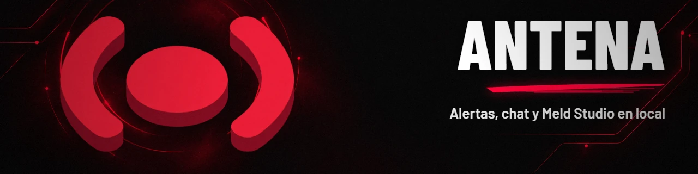
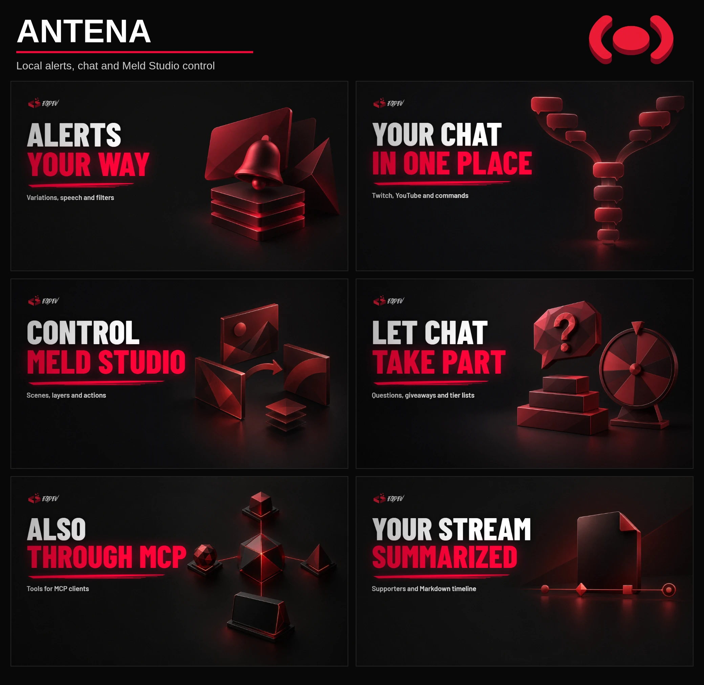

<!-- egdev:lang:start -->
<p align="right">
  
  <a href="./README.es.md"></a>
</p>
<!-- egdev:lang:end -->

<!-- egdev:header:start -->


<div align="center">

[](https://github.com/egdev6/antena/milestone/4)
[](https://github.com/egdev6/antena/blob/main/package.json)
[](https://github.com/egdev6/antena/stargazers)
[](https://github.com/egdev6/antena/issues)
[](./LICENSE)

</div>
<!-- egdev:header:end -->

# antena

Stream alerts, chat and widgets for **Meld Studio** — local, free and with the EGDEV identity. It is a **desktop app** (Tauri + React) controlled from its own panel, from the **Stream Deck**, from the **Meld chat panel** and **also from an MCP server**, so that Claude (or any MCP client) can see and change absolutely everything.

## What is it

antena runs entirely on your PC and gives your stream a full alert and interaction layer:

- **Alerts** from Twitch (followers, subs, resubs, gifted subs, bits and Power-ups, raids, rewards) and YouTube (new subscribers, Super Chats, Super Stickers, members, milestones and gifted memberships). Event → alert table: [docs/eventos.md](docs/eventos.md).
- **Three designs per alert:** the EGDEV 3D card; your own video or image (webm with transparency) with the message on top, placed wherever you want; or **video + card**: your video or image as a full-screen background with the 3D card on top, with an entry delay and position offset. All with your own CSS.
- **Variations:** another version of the alert depending on the amount, the tier, the user, the message or a probability.
- **Voice (TTS)** for messages, **filtering** of words, links and users, and **pause** with queue.
- **Actions in Meld** when an alert fires: change scene (and switch back), show or hide layers, effects, confetti, roulette, save a clip, write in chat, speak…
- **Chat commands** (`!engram`, `!web`…) that trigger their own alerts, with permissions and cooldowns.
- **Scheduled messages:** texts that post themselves to chat every X minutes (also as a highlighted announcement) and, if you want, also appear on screen as an alert.
- **Interactives:** chat question queue, a tier list the chat votes on, and giveaways with an on-screen roulette.
- **Widgets:** on-screen chat (Twitch + YouTube), goals, latest supporters, ticker, live concurrent viewers, offline follower thank-yous and end credits.
- **Custom overlays:** HTML, CSS and JavaScript layers for a scene or to frame the camera, written by you or by Claude via MCP, with live data and actions you approve.
- **Stream recap:** totals, who to thank and a timeline with the minute of each event, in Markdown.
- **Offline followers:** records Twitch followers gained while antena was closed, and YouTube's public subscribers plus an anonymous count; YouTube requires a connected account.
- **Mobile panel** on your local network, protected with a key.
- **Browser sources for Meld:** every alert, widget, panel and custom overlay is a browser source with its size, ready to copy.
- **Prompter for the Elgato Prompter** (1024×600): the app opens it full screen on that display.
- **Viewers record alert** per platform (Twitch and YouTube), with anti-spam brakes.
- **Appearance:** one theme for everything that goes on screen (alerts, widgets and credits): colors, fonts (including yours), icons per alert, shape, position, animation and sound. The default one is the EGDEV theme.
- **Customizable Stream Deck shortcuts:** each one chains steps (bookmark, pause, scene, layer, chat, prompter tab…) and has its own `/sd/custom/<id>` endpoint.
- **Dock for Meld:** the whole live show minus the preview — scenes, Meld's audio tracks, alerts, questions, vote, giveaway, teleprompter, and credits — adaptable: three columns from 768 px wide regardless of orientation, one tab per section below that.

The server has no dependencies (Node ≥ 24). The interface is React compiled with esbuild and the desktop app is Tauri 2, which starts that server as a *sidecar*. Everything stays on your PC.

<p align="center"></p>

<!-- egdev:stack:start -->
<div align="center">
<a href="https://github.com/Gentleman-Programming/gentle-ai">
  
</a>
</div>

<div align="center">


</div>
<!-- egdev:stack:end -->

## Quick start

### Windows installer

Download the `antena_<version>_x64-setup.exe` installer from the [latest release](https://github.com/egdev6/antena/releases/latest) (notes in [`docs/releases/`](docs/releases/)) and open it; it installs for your user. The installer is **not signed with a Windows certificate**: SmartScreen warns about an «unknown publisher» and you have to click **More info › Run anyway**.

**Updates:** since 0.10.0, **Settings › About** (Ajustes › Acerca de) finds and installs new signed versions without downloading anything by hand. If you come from 0.9.0, install 0.10.0 by hand once. Your data is kept.

The maintainer builds that installer from **Actions › Release** (manual workflow, only from `main`, with the version from `package.json`): it builds on Windows and creates a **draft** release with the `.exe` and the notes from `docs/releases/v<version>.md`, which is reviewed and published by hand.

### Desktop app (Windows), from source

You need, once: [Rust](https://rustup.rs) (MSVC toolchain), WebView2 (ships with Windows 11), Node 24 and pnpm (`corepack enable` installs the version pinned in `package.json`).

```powershell
cd path\to\antena
pnpm install         # React, esbuild and the Tauri CLI (only to build)
pnpm fonts           # Barlow and JetBrains Mono into public/fonts (the overlay needs no internet)
pnpm desktop:node    # copies your Node into src-tauri/binaries (the server that goes inside the app)
pnpm desktop:dev     # app in development mode (uses the code in src/ directly)
pnpm desktop:build   # installer into src-tauri/target/release/bundle/nsis
```

The app starts the server on `http://127.0.0.1:4500`, opens the panel and leaves an icon in the tray. **Closing the window leaves it in the tray**: the Meld sources and the Stream Deck keep working. To shut everything down, use «Exit» in the tray menu (it saves and stops the server cleanly).

- The installed app's data lives in `%APPDATA%\es.egdev.antena\data` and `…\media`. To keep using the data from the project folder, copy `data/` and `media/` there, or start with `ANTENA_DATA` and `ANTENA_MEDIA` pointing at them. In `desktop:dev` the project's own folders are used.
- If another antena is listening on the port with the same data directory, the app reuses it. Otherwise it does not connect and asks you to close the server occupying the port. Each data directory has a random identity bound to its real path in `instance.json`; a copied directory gets a new identity, and the status API does not expose the path.
- Another port: `"port"` in the `config.json` of the data folder in use, or the `ANTENA_PORT` variable.

### Server only (no app)

```powershell
pnpm install     # once: esbuild and React to build the interface
pnpm app:build   # builds the React interface into app/dist
pnpm start
```

Panel: http://127.0.0.1:4500/ · prompter: `/prompter` · dock: `/dock`. Without `app/dist`, the server answers with a minimal page explaining how to build the interface (`pnpm app:build`) instead of the panel. To work on the interface: `pnpm app:dev` (rebuilds on save) with `pnpm start` in another terminal.

## Scripts

| Script | What it does |
|---|---|
| `pnpm start` | Starts the server (`src/server.mjs`) |
| `pnpm app:build` | Builds the React interface into `app/dist` (esbuild) |
| `pnpm app:dev` | Rebuilds the interface on save |
| `pnpm desktop:dev` | Desktop app in development mode (Tauri) |
| `pnpm desktop:build` | Builds the Windows installer (NSIS) |
| `pnpm desktop:node` | Copies your Node into `src-tauri/binaries` (sidecar) |
| `pnpm fonts` | Downloads Barlow and JetBrains Mono into `public/fonts` |
| `pnpm test` | Runs the test suite (`node --test`) |
| `pnpm baseline` | Runs the baseline checks |
| `pnpm typecheck` | TypeScript check for `app/` |
| `pnpm mcp` | Starts the MCP server (stdio) |

## Usage guide

### Browser layers in Meld

In the panel, **Meld and Stream Deck › Sources for Meld** lists all of them with their size and a copy button (it includes one goal per goal you have). In Meld: **+ › Browser**, paste the URL and set that width and height. Meld does not allow creating layers from outside, so they are added by hand once.

| Layer | URL | Size |
|---|---|---|
| Alerts | `http://127.0.0.1:4500/overlay` | 1920×1080, with **Add audio track** |
| Chat | `http://127.0.0.1:4500/widget/chat` | 600×900 |
| Goal | `http://127.0.0.1:4500/widget/goal?id=principal` | 1000×200 |
| Latest | `http://127.0.0.1:4500/widget/latest` | 1400×200 |
| Ticker | `http://127.0.0.1:4500/widget/ticker` | 1920×64 |
| Credits | `http://127.0.0.1:4500/widget/credits` | 1920×1080 |
| Question | `http://127.0.0.1:4500/widget/question` | 1920×1080 |
| Tier list | `http://127.0.0.1:4500/widget/tierlist` | 1920×1080 |
| Giveaway | `http://127.0.0.1:4500/widget/giveaway` | 1920×1080 |
| Viewers | `http://127.0.0.1:4500/widget/viewers` | 900×160 |
| Thank-yous | `http://127.0.0.1:4500/widget/thanks` | 900×200 |

**Offline thank-yous.** This layer rotates one pending offline follower at a time and can finish with YouTube's anonymous count. In Widgets › Agradecimientos, choose platforms, all time / since the last archived stream / a number of days, the maximum names and rotation interval. Unknown follow dates remain included; with no archived stream, the last-stream window has no cutoff. Nothing pending leaves the layer transparent. Individual and confirmed bulk thank-you actions apply immediately; bulk affects only the names and anonymous records selected for the saved widget settings, not other pending followers.

**Goal bars.** Twitch followers and subs and YouTube subscribers show the platform's channel total, not just events from the stream, and do not reset between streams. Antena reads it at startup, on reconnect and every five minutes; live events add between reads. For an explicitly configured YouTube channel, detected subscribers add only when the connected account's channel ID matches; if it differs or cannot be verified, the next platform read updates the total instead. If the platform does not respond, the last known value remains; before the first read the bar shows `—`. Manual +1, −1 and Set apply a persistent correction (for example, to exclude your own sub). Twitch subs require the `channel:read:subscriptions` permission. YouTube rounds subscriber counts to three significant figures from 1,000. Other goal metrics remain per stream.

**Chat variants (server API).** `POST /api/widgets/chat/variants` with `{ "name": "Live" }` creates a named copy of every current default-chat setting. Later default changes do not propagate. Explicit creation fields must match the copied defaults; a conflicting value is rejected. `GET` on that path lists variants; `PUT` or `DELETE` on `/:id` edits or removes one. Names and settings are validated, a changed id is rejected on rename, and the default cannot be deleted. Validation applies when `chatVariants` is supplied or addressed explicitly; other config writes retain their existing merge, replacement and `null` semantics. The server lists `/widget/chat?variant=<id>` in sources and MCP; `/widget/chat` remains the unchanged default URL. The widget selects an exact variant id, and falls back to the default if it is missing, unknown or deleted. Each independent configuration has `layout: "vertical" | "horizontal"` (default `vertical`): the horizontal row puts new messages on the right and fades older ones at the left edge; `reverse` mirrors the order and directional animations. Available width and `maxMessages` limit the row, and messages are clamped to two lines. In shorter horizontal layers, vertical spacing and card height adapt; configured fonts also shrink when needed. In **Widgets › Chat en pantalla**, create a variant from the saved default, choose its layout and settings, then press **Guardar**. Copy the selected variant's URL into its Meld browser source; renaming does not change that URL. The panel suggests 600×900 for vertical chat and 1832×160 for horizontal chat; adjust these to your scene. Save or discard a draft before switching or managing variants. A standalone `?layout=` parameter is not supported for chat.

Overlay parameters: `?pos=top|center|bottom`, `&scale=0.8`, `&mute`, `&debug`. Credits: `?transparent`, `?autoplay`, `?loop`. Latest: `?layout=column`, `?items=follow,sub`. Viewers: `?platforms=twitch`, `?layout=column`, `?total=0`, `?peak=1`.

**Custom overlays** show up in that same list as «Overlay · name», with their `/custom/<id>` URL and their size.

### Meld Studio

1. In Meld: **Settings › Advanced › Allow remote connections**.
2. In the panel: **Meld Studio › Connect** (by default `ws://127.0.0.1:13376`).

From there you can see scenes, layers and tracks, change scene with a click, show or hide layers and trigger shortcuts (clip, screenshot, confetti, roulette, record). Each track also shows its **current volume**, kept in sync with Meld while you move the fader. When you go live, the panel starts a new stream by itself (this can be disabled).

**Record on start** is off by default. In Meld Studio › Connection, enable «Grabar al empezar el directo» and save. When you start the stream from antena, it asks Meld to record only after Meld confirms the stream and recording is known to be inactive. A recording already running, or a stream started in Meld, is left alone. When you stop the stream from antena, it asks Meld to stop only the recording it started and confirmed. A failure or missing confirmation appears in the dock without stopping the stream; check the recording in Meld.

Meld's public API exposes recording state, not recording IDs: an indistinguishable simultaneous recording started elsewhere cannot be attributed perfectly. Disconnections, unknown state, observed external stops and other stream/recording control commands cancel antena's ownership; check Meld before changing a recording manually. The setting is `meld.recordOnStart`; `status.meld.recordingKnown` and `status.meld.recordingWarning` are available in status, snapshots and panel SSE.

In every alert, variation or command, **Actions on fire** runs right when the alert appears on screen:

| Action | What it does |
|---|---|
| Switch to scene | Puts a scene live and, if you want, goes back to the previous one after X seconds |
| Show layer for a few seconds | Shows a layer and hides it afterwards |
| Hide / toggle layer, toggle effect | What it says |
| Meld command | Save clip, screenshot, record, go live, virtual camera, replay… |
| Meld widget event | Confetti, roulette, counter, stopwatch, countdown, subathon |
| Write in chat | Writes in your Twitch chat, your YouTube chat or both («Where» selector; if none chosen, Twitch), with `{user}` and other variables. Each platform has its own outcome: if one fails, the action is marked as failed with its reason, and what already went out on the other is not repeated |
| Say out loud | Reads a text in the overlay |

Scenes and layers are referenced by name, so you can prepare them even with Meld closed.

### Variations

In every alert, **Variations › Add variation**. Each one has:

- **Conditions:** minimum and maximum amount, tier, specific users, words in the message and probability.
- **Changes:** only what you want different (another video, sound, text, actions…). The rest is inherited from the alert; the ↺ button re-inherits a field.

If several match, the first one wins; the order is changed with ↑ ↓.

### Custom CSS

Every alert, variation, command and scheduled message has its own **Custom CSS** tab under the preview. The **Common CSS** tab applies to all alerts. The default styles live in a layer (`@layer egdev`), so your CSS always wins without `!important`. It is saved and shown in the preview instantly.

The easiest way is the variables:

```css
.alert { --accent: #00E0FF; --tilt: none; --name-size: 70px; }
.alert-name { color: #FFD400; }
.card { border-radius: 8px; }
```

| Variable | What it changes |
|---|---|
| `--accent` | Main color: glows, border, time bar and title come from it |
| `--title-color`, `--name-color`, `--sub-color`, `--hl-color` | Text colors |
| `--title-size`, `--name-size`, `--sub-size` | Font sizes (the name auto-fits if it does not fit) |
| `--font-title`, `--font-name`, `--font-sub` | Typefaces |
| `--card-width`, `--card-radius`, `--card-padding`, `--card-bg` | Card |
| `--border-width`, `--border-color` | Border |
| `--tile-size`, `--tile-radius`, `--icon-size`, `--icon-color` | Icon |
| `--tilt`, `--reflection` | 3D tilt and reflection (`none` to remove them) |
| `--text-x`, `--text-y`, `--text-w`, `--text-align`, `--media-w` | Text position over your video |
| `--ink`, `--fs` | Color and size of the text in video alerts |

Classes: `.alert`, `.card`, `.alert-title`, `.alert-name`, `.alert-sub`, `.alert-icon`, `.alert-platform`, `.alert-glow`, `.alert-dots`, `.alert-cube`, `.alert-timer`, `.alert-media` and `.type-follow`, `.type-raid`… to fine-tune per type from the common CSS.

The **snippets** buttons insert ready-made recipes: another color, no tilt, smaller, no decoration, no reflection, no platform, no icon, glass background, outlined text and heartbeat on entry. Widgets also have their own CSS field and work the same way.

### Custom overlays

A new Meld layer made of HTML, CSS and JavaScript: a frame for the camera, an animated title, a card for a scene. You write them in **Overlays**, or ask Claude via MCP (`crear_overlay`); whatever the agent does shows up in the panel without reloading.

| Where | What you get |
|---|---|
| Panel › **Overlays** | Card list, editor with HTML, CSS and JavaScript tabs, live preview, width and height, transparent background, permissions, copy URL and delete |
| Meld | **+ › Browser** layer with `http://127.0.0.1:4500/custom/<id>` and the overlay size (it is also in **Sources for Meld**, as «Overlay · name») |
| On save | Every open layer (Meld and the preview) reloads by itself: you never touch the source in Meld |

`/theme.css` is already linked: use its variables (`var(--accent)`, `var(--text)`…) to match the rest. The background is transparent by default, so it sits well over the camera, and external https resources (fonts, images) do load. Width 16–7680, height 16–4320, up to 50 overlays and 512 KB of JSON per overlay.

#### The SDK: live data and actions

`window.antena` is all there is in the page:

| API | What it does |
|---|---|
| `antena.on(event, fn)` | Listens to an event and returns the function that unsubscribes. If a value already exists, `fn` is called with it right away |
| `antena.state` | Latest value per event (`alert`, `chat`, `viewers`, `widgets`, `interactive`, `theme`); they start as `null` |
| `antena.ready` | Promise that resolves once there is data: await it before reading `antena.state` |
| `antena.run(kind, params)` | Requests an approved action: resolves when it ran, rejects with the server error otherwise |

```js
const who = document.querySelector('.who');
antena.on('alert', a => {
  who.textContent = a.vars.user;
  who.animate([{ opacity: 0 }, { opacity: 1 }], 300);
});
antena.ready.then(() => {
  who.textContent = antena.state.widgets?.latest?.follow?.user || 'EGDEV';
});
document.querySelector('.frame').onclick = () => antena.run('scene', { scene: 'Camera' }).catch(e => console.warn(e.message));
```

#### Permissions

The agent **asks** for permissions when it creates or edits; only you **approve** them in the panel (switches in the Permissions tab), and only the ones the overlay asks for can be approved. Kinds: `scene`, `layer`, `hideLayer`, `toggleLayer`, `effect`, `command`, `streamEvent`, `chat` and `say`.

- Without approval, `antena.run` is rejected (403) and nothing happens.
- Cap of **10 actions every 10 seconds** per overlay: above it, 429 and nothing runs.
- Editing the code does not revoke approvals, but the panel warns when the code has changed since you approved.

**Security.** User code runs in a sandboxed `<iframe>` with an opaque origin, on a separate page: it has no antena API, cannot read the panel and cannot open the event stream. Data only reaches it through messages from the page hosting it, and the only thing it can ask back are the actions you approve.

Over MCP: `listar_overlays`, `ver_overlay`, `crear_overlay`, `editar_overlay`, `borrar_overlay` and `probar_overlay` (fires a sample event at one open layer).

> «Make me a custom overlay with the latest follower as an animated HTML/CSS card and add it to Meld».

### Chat commands

**Chat commands › Create command.** Each command is a full alert, with its design, sound, voice and actions, plus:

- **Who can use it:** everyone, subs and members, VIPs, moderators or only you.
- **Cooldowns:** between uses and per person. Moderators and you have no cooldown.
- **Variables:** `{user}` and `{args}`, which is whatever is typed after the command.

### Scheduled messages

**Chat › Scheduled messages › New message.** Each message has:

- **Text** with variables: `{channel}` (your channel), `{title}` (stream title), `{uptime}` (time live) and `{follows}` (new followers today).
- **Every how many minutes** and **how many chat messages** must have happened since the last time. That way it does not repeat in a dead chat; your own messages do not count.
- **Where it posts:** Twitch, YouTube or both. Messages you already had keep posting to Twitch only.
- **Only while streaming** (on by default): it uses the Meld status. The countdown pauses while offline and starts a full interval when the stream starts. If Meld is not connected there is no way to know if you are live, so it **does not post**, neither alone nor with «Send now». Turn this option off to keep counting and posting while offline.
- **As a highlighted Twitch announcement**, with a color (the channel's, blue, green, orange or purple). YouTube has no announcements: with «YouTube» or «both», the same text goes there as a normal message.
- **Also on screen:** besides chat, a full alert comes out (card or video, sound, voice, Meld actions…).

Every 15 s it checks whether any message is due. The panel shows when the next one comes out, why it is waiting (paused, Meld not connected…), the result on each platform and the last error, and has «Send now».

**Limits:** 500 characters on Twitch and 200 on YouTube. When saving, the panel warns if the template no longer fits. When sending, the text is never cut: if it does not fit on one platform, it is not sent there and stays as a partial failure with the reason; the other one does receive it. The same applies to «Write in chat» actions.

The pause button also stops scheduled messages, automatic ones and «Send now». When resuming, each one restarts its full interval: whatever fell due during the pause is not recovered.

### Questions, tier list and giveaway

They live in **Widgets** and each one has its browser layer. Their state (questions, votes, participants) is saved in `data/interactive.json` and survives a restart.

**Questions.** The chat types `!question Is…?` (the command is changeable). In the panel you see the queue: move up or down, discard, add questions by hand and «Show». «Next question» takes the first one out of the queue and marks the previous one as answered. Per-person question limit, minimum length, who can ask and optional confirmation in chat. Layer parameter: `?nocount`.

**Tier list.** Create a list with its items and tiers (S, A, B, C, D by default, with editable name and color). You place each item with a click or open the vote with «Vote in chat»: the chat types the letter (`S`, `A`…) or `!tier S`, you see live how many votes each tier has and, when closed, the item goes to the most voted tier (on a tie, the higher one). Each person has one vote per item and can change it. The vote can close itself after X seconds. You can have several lists and choose which one is on screen. Layer parameters: `?id=<list>`, `?nopool`.

**Giveaway.** Choose title, prize and command (`!giveaway`, `!tshirt`…). «Open giveaway» announces it in chat; people enter by typing the command (once each). «Draw» spins the roulette with the names on screen, reveals the winner with confetti (also Meld's, if connected) and announces it in chat. You can repeat without the same winner coming out again, give subs and members better odds, and add or remove participants by hand. It keeps a giveaway history.

### Teleprompter

**Widgets › Teleprompter.** Your stream script, block by block, that scrolls at the words-per-minute you choose. **Only you see it**: open it on the monitor next to your camera («Open in window» button) or in a Meld layer that is not broadcast. The server sends the same scroll position to the window, the panel, the Stream Deck and the MCP, so they all stay in sync.

- Write each block with its text; whatever is inside **[brackets] are notes** for you: they show in yellow, are not read out and (if you enable «Pause on [brackets]») the scroll stops right before each one.
- Control: start, stop, previous/next block, back to the beginning, faster or slower (keyboard in the panel: space, ←/→, ↑/↓ and Home) and a countdown when starting. With «Reading line» you see a fixed red line and the text scrolls up; with «Mirror», flipped for the prompter reflection.
- You save several scripts (up to 50, with a total size cap) and choose which one is active. A sample script comes by default.
- In the desktop app, «Open in window» (or the **Screen** dropdown) opens the teleprompter full screen on the display you choose; **«The main one» is the system's primary monitor**. In a browser it opens a popup window.
- Stream Deck shortcuts: `/sd/teleprompter` (start or stop), `/sd/teleprompter-next`, `/sd/teleprompter-previous` and `/sd/teleprompter-start`.

### Filters and voice

- **Filter:** banned words (case- and accent-insensitive), replacement, links replaced with «[link]», blocked users (they trigger no alerts and do not appear in chat) and maximum length. It applies to alerts, voice and chat.
- **Voice:** uses the Windows voices. You choose voice, rate, pitch, volume and maximum length. In each alert it is enabled with its template («{user} says: {message}») and a minimum amount.

### Stream, chat and history

- **Stream:** totals, goals, timeline, Markdown recap (copy or download), launch credits and start a new stream (the previous one is archived with its recap). Optionally show the on-screen chat widget preview with real messages and choose a saved variant, and independently show the real thank-you widget with pending offline followers; the panel remembers these choices in this browser. The thank-you preview is empty when the widget has no pending followers to show. Channel-total goal bars keep their values and corrections across streams; other goals count per stream.
- **Session identity:** known YouTube and Twitch IDs appear in `/api/sessions` and `listar_directos`; a different ID on reconnect starts a new session, otherwise the first ID is kept.
- **Viewer history:** automatic live sessions retain every captured sample and error/offline/disconnection gap per platform. JSON summaries expose `viewers` and `viewerMetrics`; `/api/sessions` and `listar_directos` expose only metrics. Average is time-weighted, peak and coverage stay separate per platform (never summed). Each sample covers at most its polling interval; gaps and restart downtime are never interpolated.
- **Chat metrics:** automatic Meld sessions persist unique chatters and message/minute counts per platform, independently of the 300-message buffer. Simulated and identifiable streamer messages are excluded.
  JSON summaries expose `chatMetrics` and nonempty minute buckets relative to session start; lists omit the series. The average uses the full session duration (`null` at zero duration).
  Messages without an author ID count as messages, never as unique chatters by name. Author sets stay private; no message text is stored for analytics.
- **Session retention:** by default all archived streams are kept. With `sessions.retention` (in `data/config.json`) set to a number N, after each stream only the N most recent archives remain (each stream's media is never deleted). The panel list is fed by lightweight metadata, without reading each whole file.
- **Chat:** Twitch and YouTube together and filterable, with each platform's icon. You write to **Twitch, YouTube or both** (the selector next to the text box; it is remembered and also applies to the prompter and the MCP). **Your own messages do not appear in the on-screen chat** (Widgets › On-screen chat › «Hide my messages», on by default) and do not go through the link filter.
- **History:** the latest alerts, with «Replay».
- **Raw event log:** every event received from YouTube and Twitch is appended to `data/raw-events.jsonl` (one JSON line: `at`, `platform`, `kind`, `handled`, `raw`). `handled: false` marks what the platform sent and antena ignored, which helps find missing alerts. Above 5 MB the file rotates to `raw-events.1.jsonl`.
- **Pause:** fixed button in the sidebar. Stops on-screen alerts and scheduled messages (automatic ones and «Send now»). Alerts that arrive are stored and, on resume, they fire or get discarded; each scheduled message restarts its interval. What you type in chat is never paused.

### Prompter

A 1024×600 view designed for the **Elgato Prompter**: you read chat and handle the widgets while looking at the camera, with the mouse. It lives at `http://127.0.0.1:4500/prompter`.

1. Connect the Prompter over USB-C: Windows sees it as another display.
2. In the desktop app, **Prompter › Open on the Prompter** (or the «Prompter» button in the side menu, or the tray): it detects the 1024×600 display and opens the view full screen on it. You can pin a different display in **Meld and Stream Deck › Prompter**. Without the app: open `/prompter` in Chrome or Edge as an app window, drag it to that display and press F11.
3. The Prompter flips the image itself; if you see it reversed, enable «Mirror» in **Settings › Prompter**.

What it carries:

- **Top:** stream time and warnings only when something is wrong (mic muted in Meld, alerts paused, Twitch or YouTube down, no overlay), about half the height it used to be.
- **Left, the Twitch and YouTube chat in one column.** Commands and votes do not appear. Messages a viewer sends with «Highlight my message» appear highlighted. On mouse hover, the chat pauses and each message gets ❓ (to the question queue) and 📌 (save to the timeline). At the bottom you can write to the Twitch chat.
- **Right, two tabs:**
  - **Events,** two stacked blocks that fill the height. **Timeline:** alerts with ✔ (thanked) and ↺ (replay), short bookmarks (rename them with a click), questions shown and winners, each with its minute and its platform logo, and a «to thank» mark on alerts you have not thanked yet. **Highlights:** the messages a viewer highlights in Twitch and the ones you save with «Save», with platform logo, user and minute. The tab counts what is still to thank.
  - **Questions:** take any of them out of the queue with a click, next, hide and discard; the tab counts the ones waiting.
- The tier list and the giveaway are handled from the dock and their panel pages; the prompter no longer switches tabs by itself.

**Short bookmarks** land in the Events tab with their minute and, if you are live, also as Twitch markers (permission `channel:manage:broadcast`: reconnect Twitch once). They appear in the stream recap, under «Bookmarks for shorts».

### Appearance

In **Settings › Appearance** you change the theme of **everything that goes on screen**: alert overlay, chat, goals, latest, ticker, question, tier list, giveaway and credits. There is a single theme; the default is the EGDEV one and whatever you change here overrides it. While you change it, only the panel preview shows it (a draft in `/api/theme/draft` that only `?themeDraft` previews load); pressing **Save** sends it to every layer open in Meld at once, without reloading them. If saving fails, the draft stays and the panel warns; a starting point, an import or «Restore EGDEV» are applied and saved right away and drop the draft.

- **Color:** accent, soft accent, card background (gradient, solid or glass, with its opacity), texts, border (accent or its own), glow intensity and, if you want, the color of each platform.
- **Typography:** title and body fonts (the brand's, the system's or your own in woff2/woff/ttf/otf uploaded in General and files), alert text size, uppercase and black outline.
- **Icons:** stroke, color, box shape, platform label (text, logo or none) and the icon of each alert type: a default one, its platform's logo, an emoji, your own image or none.
- **Shape and effects:** corners, alert width and scale, 3D tilt, reflection, decorations and time bar.
- **Position and motion:** alert height and side, fine adjustment and enter/exit animation (3D spin, slide, fade, bounce or none). A `?pos=` in the overlay URL still wins.
- **Sound:** the default alert sound (the EGDEV tone, none or one of yours) and its volume.
- **Starting points** (EGDEV, Cyan, Emerald, Amber, Each platform's color, Sober, Glass), **export** and **import** the theme as JSON and **Restore EGDEV**.

The theme is served at `/theme.css`, in the `egdev-theme` layer, above the default styles: each alert's or widget's own CSS still wins. It is validated the same way on every write path (`PUT /api/theme`, `PUT /api/config`, `POST /api/config/set` and the loading of `config.json`): an invalid value is rejected with 400 and `/theme.css` never emits anything unvalidated; ranges (glow, size, position…) are rejected with the same schema message everywhere except on **import**, which clamps so that previously exported themes still load. Via MCP: `ver_tema`, `cambiar_tema`, `tema_de_partida`, `restaurar_tema`, `importar_tema`. The prompter and the teleprompter do not change: they are for you, not for the stream.

### Viewers record

Two more alerts, **Viewers record** on Twitch and on YouTube (`viewers` and `ytviewers`), which fire when more people are watching at once than ever before on that platform. You design them like any other alert (card or video, sound, variations, Meld actions). Their **Record** tab shows the current figure, the stream's peak and the saved record, which you can set by hand or reset to zero.

Every minute it checks how many people are watching (Twitch: `streams`; YouTube: `videos.list`, 1 quota unit). The record is always saved; what is slowed down is the alert:

- **Confirmation:** it takes the minimum of the last readings (2 by default): a loose spike is not a record.
- **Minimum jump:** it only alerts if it beats the last announced figure by 3 people or 10 %, whichever is greater. With a record of 40, from 44 up.
- **Wait between alerts:** 15 minutes per platform. Whatever is broken meanwhile comes out **once** at the end of the wait, with the highest figure.
- **Warm-up:** the first 5 minutes of the stream do not alert.
- **Minimum:** below 5 viewers it does not alert.
- **First time:** with no saved record, the first figure is the starting point, no alert.

Everything is adjustable in that tab or via MCP. These alerts do not count as events (goals, totals, ticker, credits) and do not ask for «thanks».

#### Stream Deck

What belongs to a button goes to the Stream Deck. With a web requests plugin (for example «API Ninja»), each button calls one of these endpoints (GET or POST, no body):

| Endpoint | What it does |
|---|---|
| `/sd/marca` | Short bookmark |
| `/sd/pausa` | Pause or resume alerts and scheduled messages |
| `/sd/saltar` | Skip the alert on screen |
| `/sd/siguiente-pregunta`, `/sd/ocultar-pregunta` | Question queue |
| `/sd/cerrar-votacion` | Close the tier list vote |
| `/sd/abrir-sorteo`, `/sd/cerrar-sorteo`, `/sd/sortear` | Giveaway |
| `/sd/agradecido` | Mark the oldest pending one as thanked |
| `/sd/prompter/cronologia` · `/sd/prompter/preguntas` | Switch the prompter tab (Events · Questions). The retired `tierlist` and `sorteo` answer without switching, so old shortcuts keep running |

Scenes, mic and loose effects go directly with the Meld plugin for Stream Deck.

**Shortcut security.** The `/sd/*` endpoints have effects, so on top of the usual CSRF blocking (Origin and `Sec-Fetch-Site`), a GET with a `Referer` from another origin, or with browser headers but no `Sec-Fetch-Site` (e.g. an `` on a third-party site from an old browser), is rejected with 403 and nothing runs. The Stream Deck plugin, which sends none of those headers, and a same-origin browser keep working without configuring anything.

**Custom shortcuts.** In **Meld and Stream Deck › Shortcuts and Stream Deck** you create buttons that chain several steps, in order: any of the ones above, switching the prompter tab, and the Meld and chat actions (scene, show/hide layer, effect, command, widget event, write in chat, say out loud), each with its own delay. Every shortcut has its endpoint, `/sd/custom/<id>` (the name also works: `/sd/custom/Start%20stream`), a test button and a color. If a step fails, the rest still run and the response says which one failed. They can also be created and triggered from the MCP (`crear_atajo`, `lanzar_atajo`…).

### Dock in Meld

The **Paneles** page also puts either the prompter or the teleprompter on the selected screen (only one at a time), and offers floating dock and teleprompter windows. In a browser they open as popups and their window state is unavailable.

Meld does not support custom panels, but its **chat panel** loads a URL. Put `http://127.0.0.1:4500/dock` there (**File › Preferences › User Interface**), or open it from **Paneles › Ventanas flotantes › Abrir el dock**; in the app it also opens as an always-on-top floating window from the tray. Without leaving Meld it has the whole live show minus the preview, with the stream state and the warnings (mic, pause, Meld, overlay) on the header:

- **Control:** start or stop Meld's broadcast after confirmation, and see current Twitch and YouTube viewers separately. **Starting broadcasts for real, publicly**, through Meld. With Meld's automatic session enabled (the default), antena creates its session when Meld confirms it is streaming; the dock does not create a second session. If automatic sessions are disabled, it does not create one. The dock waits for Meld's confirmation and warns if none arrives; connect Meld first. A missing, offline, errored or stale viewer reading is shown as `sin dato`, not zero. Control also has pause/resume alerts (with the queue), skip, short bookmark, thanked (with pending count), scenes, teleprompter (previous, play/pause, next, start) and credits (launch, stop). Each horizontal scene appears once; a matching ` [Vertical]` scene is also shown in Meld when clicked. Unpaired vertical scenes remain available. On-air labels distinguish H, V and H + V; long names retain their full accessible name.
- **Audio:** global tracks and those of the on-air scenes, each with a mute switch and a fader for the **real gain**. If Meld does not report a track's volume, its fader is disabled. The narrow Audio tab signals muted listed tracks.
- **Interactivos:** tabs for questions (switch, current, next, hide and queue), tier list vote (close and place, cancel) and giveaway (open/close, draw, participants), with status badges.

At **768 px wide or more, regardless of orientation**, the columns are **Control | Audio | Interactivos**; below 768 px they become tabs. Both tab levels support arrow keys and remember the last selection. There is no chat, preview or shortcuts module in the dock; shortcuts remain in the panel and Stream Deck.

### Panel

The interface (panel, prompter and dock) is React, in `app/src`, and is built with `pnpm app:build`. It uses **EGDEV Foundation** (Material v2 + Grafito): `public/ds/tokens.css` and `public/ds/bundle.css` are synced from egdev-design-system and stamped with the source commit, and `panel.css` only applies its recipes (tonal surfaces, light border, two-layer shadows, wells in fields, primary button with gradient). Update them with `pnpm ds:sync`; `--build` compiles the tokens first, and `--from` or `EGDEV_DS` points to the design system repository. The prompter keeps the black canvas so it reads well through the glass. The Twitch and YouTube logos are painted in color (single font in `public/platform-icons.js`) in the panel, the prompter, the dock and the chat and goal widgets. The stream overlays and widgets are out of scope: their Show-register redesign is pending in the system.

**Hierarchy (v2).** Every page follows the same pattern: a header with a single main action («+ New command», «+ New message»…), up to four indicators, and a table with search and filters. Clicking a row opens a **full-width panel** with tabs (back ←, ✕ or Esc to close). Variations open a second level over their alert (*Alerts › Raid › Variation*). Pages without a list (Appearance, Questions, Giveaway, Filters and voice, General, Meld Studio, Prompter and dock) are split into linkable **page tabs** (`#/apariencia/iconos`). Creating works the same everywhere: «+ New X» opens the same panel in «New» mode with the minimum fields and a starting template; the other tabs open after creating. The sidebar also has a **Create** button.

**Cards for the catalog (v3).** What the app offers, which only grows when the app gets new features, is shown as grouped cards: **Alerts** (by platform, the viewer record with its own), **Connections** (Platforms · Production and access) and **Widgets** (Screen layers · Handled live). Each card has a thumbnail, status, tags and its main action; an alert with a video shows its first frame and, on hover, a looping silent preview. Each alert's «Active» switch applies right away. What you create stays in tables and lives inside its card: goals open from the «Goals» card (`#/widgets/objetivos`).

**Manual save.** On configuration pages nothing is saved until you press **Save**; the footer says how many changes are pending and **Discard** goes back to what was saved. Tabs with changes show a dot. Leaving the page with changes asks first (and so does the browser when closing). Alert, command, message and theme previews show the draft; widget previews show what is saved. Live operations apply right away: enabling/ordering variations, placing in the tier list, opening or drawing the giveaway, moving questions, goal counters, connecting and deleting files. Old addresses (`#/alerta/…`, `#/comando/…`, `#/widget/…`) still work.

The sidebar lists collapse with a click on their title and the panel remembers which ones you left closed. **Alt+click** leaves only that list open. With a list collapsed, the section you are in stays visible, and a red dot warns if something inside is running (vote, open giveaway, questions in queue).

### From your phone

**Settings › General › Access from your phone** (also in Settings › Connections). When enabled, the panel listens on the local network and gives you a key-protected link (`http://192.168.x.x:4500/?key=…`). Open it once on your phone and it is remembered. «Generate another key» invalidates previous links.

### MCP server

Everything the panel does can be done via MCP (143 tools). If the app is not running, the MCP starts it itself.

Claude Desktop (`claude_desktop_config.json`):

```json
"antena": { "command": "node", "args": ["C:\\path\\to\\antena\\src\\mcp.mjs"] }
```

| Group | Tools |
|---|---|
| State and config | `estado`, `ver_config`, `cambiar_config`, `fijar_valor`, `borrar_valor`, `css_global` |
| Alerts | `listar_alertas`, `ver_alerta`, `editar_alerta`, `restaurar_alerta` |
| Variations | `crear_variacion`, `editar_variacion`, `borrar_variacion`, `ordenar_variaciones` |
| Fire and control | `probar_alerta`, `simular_evento`, `lanzar_alerta`, `decir`, `pausar_alertas`, `reanudar_alertas`, `saltar_alerta`, `vaciar_cola`, `historial_alertas`, `repetir_alerta` |
| Commands | `listar_comandos`, `crear_comando`, `editar_comando`, `borrar_comando` |
| Scheduled messages | `listar_mensajes`, `crear_mensaje`, `editar_mensaje`, `borrar_mensaje`, `enviar_mensaje_ahora`, `anunciar_chat` |
| Questions | `listar_preguntas`, `anadir_pregunta`, `mostrar_pregunta`, `ocultar_pregunta`, `marcar_pregunta`, `mover_pregunta`, `vaciar_preguntas` |
| Tier list | `crear_tierlist`, `editar_tierlist`, `borrar_tierlist`, `anadir_elementos`, `editar_elemento`, `quitar_elemento`, `colocar_elemento`, `reiniciar_tierlist`, `mostrar_tierlist`, `abrir_votacion`, `cerrar_votacion`, `cancelar_votacion` |
| Giveaway | `estado_sorteo`, `abrir_sorteo`, `cerrar_sorteo`, `sortear`, `anadir_participante`, `quitar_participante`, `reiniciar_sorteo` |
| Interactives | `estado_interactivos`, `configurar_interactivos` |
| Files | `listar_archivos`, `importar_archivo` (from a path on your PC), `borrar_archivo` |
| Chat | `leer_chat`, `escribir_chat` (Twitch, YouTube or both), `simular_chat`, `unir_chat`, `youtube_conectar_cuenta`, `youtube_desconectar_cuenta` |
| Widgets | `ver_widgets`, `editar_widget`, `crear_objetivo`, `editar_objetivo`, `borrar_objetivo`, `sumar_objetivo`, `fijar_objetivo`, `lanzar_creditos`, `parar_creditos` |
| Custom overlays | `listar_overlays`, `ver_overlay`, `crear_overlay`, `editar_overlay`, `borrar_overlay`, `probar_overlay` (fires a sample event at one open layer) |
| Stream | `resumen_directo`, `metricas_directo`, `nuevo_directo`, `renombrar_directo`, `listar_directos`, `eventos_directo` |
| Appearance | `ver_tema`, `cambiar_tema`, `tema_de_partida`, `restaurar_tema`, `importar_tema` |
| Viewers record | `estado_espectadores`, `configurar_espectadores`, `fijar_record_espectadores` |
| Timeline and prompter | `cronologia`, `crear_marca`, `nota_cronologia`, `editar_nota_cronologia`, `borrar_nota_cronologia`, `marcar_agradecido`, `prompter_pestana` |
| Meld | `meld_estado`, `meld_conectar`, `meld_desconectar`, `meld_escena`, `meld_capa`, `meld_efecto`, `meld_comando`, `meld_evento`, `meld_audio`, `meld_media`, `meld_propiedad`, `meld_llamar`, `ejecutar_acciones` |
| Teleprompter | `estado_teleprompter`, `controlar_teleprompter` (play, pause, toggle, reset, next, prev, block, seek, faster, slower), `configurar_teleprompter`, `crear_guion`, `editar_guion`, `elegir_guion`, `borrar_guion` |
| Connections | `twitch_conectar`, `twitch_desconectar`, `youtube_escuchar`, `youtube_parar`, `acceso_movil` |

`ver_config` / `cambiar_config` / `fijar_valor` reach any setting by path (`alerts.raid.variations.0.overrides.media`, `widgets.chat.fontSize`, `filters.blockedWords`…). The path is validated with the same schema as `cambiar_config`: it does not accept `__proto__`, `constructor` or `prototype` (neither in the path nor in the value, which are logged), nor going below a simple value. In lists, an index greater than the length is rejected (400) instead of leaving holes, and deleting a leaf or section of the schema restores its default value immediately, just like at startup.

Examples of what you can ask Claude to do:

- «Create a variation of the raid for more than 50 people with the raid-grande.webm video and switch to the Raid scene for 10 seconds».
- «Set a goal of 1,500 channel followers and launch the credits when it ends».
- «Every 20 minutes remind in chat that the code is at github.com/egdev6, as a purple announcement».
- «Make a tier list of testing tools with Vitest, Jest, Playwright and Cypress and open the vote for Vitest».
- «Open a giveaway for an EGDEV t-shirt with !camiseta and, when I tell you, draw it».
- «Turn all alerts cyan and remove the tilt».
- «Name today's short bookmarks after what happened in chat that minute».
- «Block the word spoiler and the user troll123».
- «Give me today's stream recap for LinkedIn».
- «Make me a custom overlay with the latest follower as an animated HTML/CSS card and add it to Meld».

### REST API

`POST /api/meld/stream` accepts exactly `{ "action": "start" }` or `{ "action": "stop" }` and requests the corresponding explicit Meld streaming command. It returns HTTP 200 with `{ "requested": "start" | "stop", "streaming": true | false | null }`: `streaming` is Meld's confirmed state before the request, or `null` if unknown, not confirmation that the requested action completed. Invalid bodies, including repeated `action` keys, return 400; disconnected Meld or an already-confirmed target state returns 409 without sending a command. Across clients, a repeated action also returns 409 until Meld confirms the change or 20 seconds elapse; a failed response may still mean the command was sent. Starting and stopping affect the real public broadcast; the existing automatic session, if enabled, handles the antena session when Meld reports the transition.

`GET /api/followers` lists the local follower registry, anonymous YouTube counts and sync status (`?pending=true` shows only unthanked records). Add `shown=true` to include the exact records selected by the saved thanks widget configuration. `POST /api/followers/thank` accepts `{ "ids": ["<id>"] }` or `{ "all": true }` to mark them thanked; `all` also marks anonymous counts and entries without an ID. Alternatively, `{ "entries": [{ "platform": "twitch", "id": "<id>" }, { "platform": "youtube", "name": "<name>" }], "anonymous": ["<at>"] }` targets exact platform/id pairs, platform/name pairs only when the ID is absent, and YouTube anonymous records by timestamp (including `null` for an unknown timestamp). Either array may be omitted; non-null timestamps must exactly match their canonical ISO form (for example, `2026-01-01T00:00:00.000Z`). Add `"onlyShown": true` to this selective form to require every selected record still to be in the widget's current selection; otherwise — or if a selection also matches a hidden pending record with the same identity, e.g. duplicates in a hand-edited file — the whole request returns 409 without changing the registry. The panel uses this guard for individual and bulk actions. Invalid requests return 400 without changing the registry; an unreadable registry returns 503.

`POST /api/session/end` ends the current session and returns `{ session }`. An optional body `{ "id": "<session-id>" }` protects against ending a different session; an invalid id returns 400, and a changed current session returns 409. It is idempotent for an already ended session, closes viewer gaps and preserves the data; archiving and resetting still happen on the next `POST /api/session/new`. It returns 409 while Meld is connected and confirms it is streaming. Normal mutating-route origin checks apply.

The panel and the MCP use the same API at `http://127.0.0.1:4500/api/…` (`/api/state`, `/api/alerts/:type`, `/api/alerts/:type/variations`, `/api/commands`, `/api/widgets`, `/api/goals`, `/api/session`, `/api/meld/*`, `/api/chat/*`…). The full list is in `src/server.mjs`. The layers receive events at `/api/stream`; each connection has a budget of pending bytes: if a client does not consume its queue, the server sends it a `gap` event and closes it; on reconnect it receives an updated snapshot and the panel shows a visible warning. Ephemeral events lost during the gap are not replayed; persisted critical records (e.g. donations) are kept.

Layers connect via WebSocket (not limited to six connections per host), falling back to SSE when WebSocket is unavailable.

#### Final session metrics (export v1)

Read-only, for **ended automatic Meld sessions**; manual and ongoing sessions are not exported. On the same PC use the existing local API access at `127.0.0.1` or `::1`, with the same admission checks and no new credential:

- `GET /api/metrics/v1/sessions?limit=50&before=<id>` uses the same window as `/api/sessions`: the 50 most recent archives by archive id, plus the ended automatic current session. Eligible results are sorted by start time then id descending. `limit` is 1–50 (default 50). Use `next` as `before` for the next page; `next: null` ends pagination. Invalid or repeated limits or cursors return 400.
- As in `/api/sessions`, an unreadable archive without usable metadata is skipped by the list; its detail URL returns 500. If metadata lists an archive whose contents cannot be read, the metrics list also returns 500 rather than inventing values.
- `GET /api/metrics/v1/sessions/<id>` returns one ended automatic session, or 404 for an unknown, ongoing or manual session. Corrupt stored data returns 500. MCP `metricas_directo` accepts an optional `id`; without it, it returns the most recent ended session.

Each document has `schema: "antena.session-metrics"`, `version: 1`, `generatedAt`, `session` and `metrics`; list pages contain these session/metrics pairs in `sessions`. The session identifies Twitch and YouTube separately with the known external id (or `null`) and `live`. Ten final rows cover both platforms: `viewers_average`, `viewers_peak`, `chat_unique_chatters`, `chat_messages` (unit `count`) and `chat_messages_per_minute` (unit `per_minute`). Every row has `source`, `capturedAt` (session end), and `coverage`. Sources are `twitch.helix.streams`, `youtube.videos.liveStreamingDetails`, `twitch.irc`, and `youtube.liveChat.messages`. Times are UTC ISO 8601 and durations are integer seconds.

Viewer `viewer_samples` coverage reports observed seconds and `ratio = coveredSeconds / liveSeconds` over those exported integers; `liveSeconds` is the session duration rounded down, and less than one covered second is reported as unavailable (`value: null`, ratio 0). Gaps are excluded from the weighted average. Chat `platform_presence` coverage has `coveredSeconds: null`: ratio 1 means the platform was live and its chat listener connected, not that its uptime was measured. Ratio 0 with `value: null` means unavailable, not zero; a connected silent chat produces real zeros. The per-minute rate is `null` at zero duration. Platforms are never summed.

Version 1 allows additive fields, metrics and coverage bases; removing or renaming fields or changing definitions requires a new version and `/api/metrics/v2/…`.

#### Optional local push

Push is **off by default**. To send an ended automatic session to a local receiver, set both process environment variables before starting antena. For example, in PowerShell:

```powershell
$env:ANTENA_PUSH_URL = 'http://127.0.0.1:4311/api/v1/ingest/antena/sessions'
$secret = Read-Host 'Receiver token' -AsSecureString
$env:ANTENA_PUSH_TOKEN = [System.Net.NetworkCredential]::new('', $secret).Password
pnpm start
```

Only explicit `http://127.0.0.1:<port>` or `http://[::1]:<port>` URLs are accepted, optionally with a path: no credentials, query or fragment. The token is sent only as a Bearer authorization header. It is not saved in the delivery queue or exposed by the status and config APIs. Protect the process environment and the session data directory.

The POST body is the existing v1 detail document, with no added fields, and is limited to 256 KiB. Each retry reuses the same bytes; a later GET can have a different `generatedAt` because it generates a fresh document. Responses 200/`stored` and 200/`unchanged` complete delivery. HTTP 408, 429, 5xx and connection failures retry up to five total attempts, with waits of 1, 2, 4 and 8 seconds; other responses are permanent failures. Each request has a five-second timeout. A failed receiver does not hold up session capture or ending.

Up to 100 pending documents, their attempt count and retry time, and the IDs of delivered or permanently failed sessions are stored in `push-export.json` in the data directory. It contains session metrics but no token; keep it private and use only one antena process per data directory. A changed receiver leaves the old queue pending rather than sending it to the new address. On startup, after a successful end and as queue space opens, antena reconciles finished automatic sessions still present in the data directory against those IDs. Enabling push can therefore send older finished sessions too. If the queue is full, a document is too large, or the queue cannot be read or written, delivery reports an error. An oversized stored document is permanently rejected without holding up later items.

Automatic sessions that end while push is enabled, and older eligible archives discovered during reconciliation, remain protected until their queue or permanent-failure record is durable. This also covers a recovered ended current session after an interrupted cutover, including a disabled restart after the first queue write failed. Archives awaiting reconciliation while push is enabled, or while a saved queue remains pending, can temporarily exceed configured session retention. Normal retention resumes after the record is saved; ordinary sessions captured with push disabled and no saved queue retain their usual behavior.

Delivery uses **at-least-once**, not exactly-once, semantics: a crash after a POST but before its result is durably recorded can cause another POST. The receiver **must be idempotent**. A permanent response can also be repeated if a crash occurs before its record can be saved. Delivery is not guaranteed after the retry limit, a permanent failure, loss of queue data, or external removal of an unsent session. Last success and error are in-memory; pending survives restart. `GET /api/status`, `GET /api/state` (`status.push`) and MCP `estado` show the last success, sanitized last error and pending count.

### Twitch

1. Create an app at https://dev.twitch.tv/console/apps/create:
   - Redirect URL: `http://localhost`
   - Client type: **Public** (no secret needed)
2. Paste the **Client ID** into **Connections** and click **Connect**; enter the code on the Twitch website.

Permissions: `moderator:read:followers`, `channel:read:subscriptions`, `bits:read`, `channel:read:redemptions`, `user:write:chat` (to write in chat) and `moderator:manage:announcements` (for announcements). If you connected with an older version, reconnect to add the new ones. Chat is read over anonymous IRC, no extra permissions.

### YouTube

1. In Google Cloud Console enable the **YouTube Data API v3** and create an **API key**.
2. Paste it into **Connections**, with your channel ID (`UC…`) or the stream link, and click **Listen to chat**.

**Automatic connection:** when Meld starts streaming (or antena starts with the stream already live), antena starts listening to the YouTube chat on its own, without your account. While YouTube does not show the stream yet, it retries every 30 s, up to 10 times (with a channel ID each attempt costs 100 quota units; with the stream link, much less). When the stream ends, the chat stops and the status is cleared. If a configured platform (Twitch or YouTube) is still not connected a few seconds after the stream starts, the panel shows a warning with a button to connect each one.

Quota: 10,000 units per day. Each chat read costs about 5, so with 8 s between reads there is enough for about 4 hours.

**New subscriber alert (`ytsub`):** connect the channel's account as described below. While the chat is listening, antena checks public subscribers every 120 seconds by default; set the interval in **Connections › YouTube** (minimum 60 seconds, 0 disables polling). The first read is a silent baseline; later newly detected subscribers get an alert and enter the local follower registry. Only public subscriptions have names, alerts are delayed by the polling interval, and the API may limit the number returned. Each subscriber-list page costs one quota unit, plus an account-total read; the daily quota is shared with chat. A `quotaExceeded` error stops subscriber polling until the next listening period.

When available, the subscriber's thumbnail appears beside the alert without replacing its icon or media. The overlay accepts only initial HTTPS avatar URLs on `ggpht.com` or `googleusercontent.com` and their subdomains; the browser loads them without a referrer and may follow redirects. Other hosts are conservatively rejected. If the image is missing, rejected or fails to load, the alert keeps its name, icon and media without an avatar.

**Writing in the YouTube chat** needs your account (once):

1. In the same Google Cloud project, configure the OAuth consent screen (external) and add yourself as a test user with the channel's account.
2. Credentials › Create OAuth client ID › **Desktop app**. Copy the Client ID and Client secret into **Connections › YouTube › Your account**.
3. Click **Connect account**, choose the channel's account and accept. Google returns to `http://127.0.0.1:4500/oauth/youtube` and antena stores the grant in `data/secrets.json`.

To write, the chat has to be listening (it is the ongoing stream's chat). Each message costs about 50 quota units.

### Files

Videos, images and sounds are uploaded from the panel (or with `importar_archivo` via MCP) and saved in `media/`. Formats: webm, mp4, gif, png, webp, mp3, ogg, wav; up to 300 MB. In **Log › Files** each file shows its size, the folder total and **where it is used** (alerts and their variations, commands, messages); the «Unused» filter helps clean up.

### Variables

| Alert | Variables |
|---|---|
| Follower | `{user}` |
| New YouTube subscriber | `{user}` `{avatar}` (optional URL) |
| Subscription | `{user}` `{tier}` |
| Resubscription | `{user}` `{months}` `{tier}` `{message}` |
| Gifted subs | `{user}` `{amount}` `{tier}` |
| Bits | `{user}` `{amount}` `{message}` |
| Raid | `{user}` `{amount}` |
| Reward | `{user}` `{reward}` `{input}` |
| Super Chat | `{user}` `{amount}` `{amountText}` `{message}` |
| Super Sticker | `{user}` `{amount}` `{amountText}` |
| New member | `{user}` `{level}` |
| Member milestone | `{user}` `{months}` `{message}` |
| Gifted memberships | `{user}` `{amount}` `{level}` |
| Viewers record (Twitch and YouTube) | `{amount}` `{previous}` `{platform}` |
| Command | `{user}` `{args}` `{command}` |

If a piece of data is missing, the « · » separator disappears on its own.

## Architecture

```
src/server.mjs     HTTP server, REST API and SSE
src/mcp.mjs        MCP server (stdio)
src/engine.mjs     engine: filters, variations, pause, actions, chat and commands
src/alerts.mjs     types, templates, variations and event normalization
src/session.mjs    stream log, totals, goals, credits and recap
src/meld.mjs       Meld Qt WebChannel client
src/twitch.mjs     Device Code login, EventSub and chat sending
src/chat.mjs       Twitch chat over IRC
src/youtube.mjs    YouTube live chat
src/commands.mjs   chat commands
src/timers.mjs     scheduled messages
src/interactive.mjs questions, tier list and giveaway
src/filters.mjs    word, link and user filter
src/store.mjs      config and secrets in data/
src/raw-events.mjs raw platform event log (data/raw-events.jsonl)
public/            overlay, widgets, design system tokens and the minimal page without app/dist
app/src/           React interface: panel/, prompter/, dock/, lib/ (live state, API, desktop)
app/splash/        desktop app splash screen
src-tauri/         desktop app (Tauri 2): starts the server, windows, tray
scripts/           build-app.mjs (esbuild), fetch-node.mjs (sidecar), fonts.mjs
media/             your videos, images and sounds
test/              pnpm test (includes a simulated Meld)
```

## Pending

- Kick.
- Paid voices (ElevenLabs, Azure) for the voice.

## Contributing

Read the issue and related PRs first: the current project state, known limits and the real-world test checklist live in [docs/estado.md](docs/estado.md). New bug/feature reports enter `status:needs-review`; review is manual. Declared checks are `pnpm test` and `pnpm baseline`. See [CONTRIBUTING.md](CONTRIBUTING.md) for the full rules.

The CI scanner and its trust model are described in [Code safety](docs/code-safety.md).

## Resources

- [docs/estado.md](docs/estado.md) — current state, known limits and the real-world test checklist.
- [docs/releases/](docs/releases/) — release notes per version.
- [docs/](docs/) — security and platform contracts (Windows FS, shutdown, server admission).

## License

Released under the [MIT License](./LICENSE). Copyright © 2026 Enrique Gómez Navarro.

<!-- egdev:contact:start -->
<div align="center">

[](https://egdev.es)
[](https://www.youtube.com/@egdev6)
[](https://twitch.tv/egdev6)
[](https://x.com/egdev66)
[](https://www.linkedin.com/in/egdev6/)
[](https://www.instagram.com/egdev6/)
[](https://github.com/egdev6)

[](mailto:egdev6@gmail.com)

</div>
<!-- egdev:contact:end -->

<!-- egdev:footer:start -->
---

<div align="center">

**⭐ If you find this project useful, consider giving it a star on GitHub ⭐**

</div>
<!-- egdev:footer:end -->
