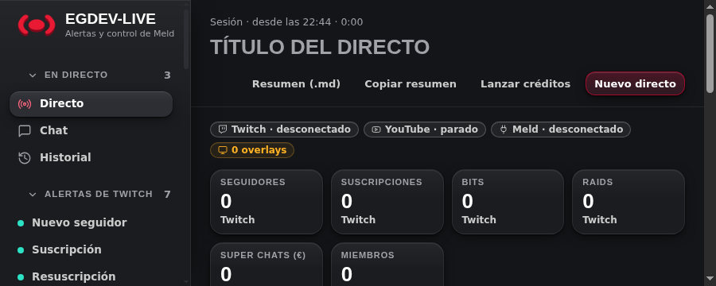
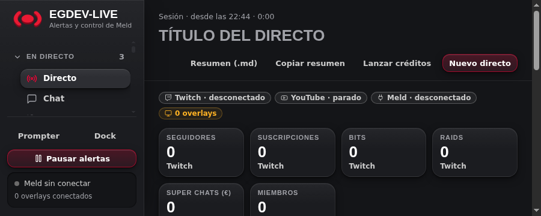

# Barra lateral: antes y después (#125)

El logo y los controles inferiores permanecen visibles en ventanas bajas;
solo la navegación lateral hace scroll. Los grupos quedan alineados a la izquierda,
con sangría en sus elementos, y el icono activo usa el color de hover.

## Comparación

Antes: `75d3b07`. Después: código de `1dc09da` (CSS y prueba de navegador).
Diez PNG, 968.206 bytes en total, capturados con datos sintéticos en Linux,
Node 24.20.0 y Chrome 148.0.7778.167. Prompter/Dock aparecen mediante un puente
Tauri simulado: estas imágenes no acreditan hardware ni la app Tauri real.
No contienen cuentas, conversaciones, credenciales ni configuración privada.

| Ventana | Antes | Después |
| --- | --- | --- |
| Ancha · 1360×860 | [Antes](before-wide.png) | [Después](after-wide.png) |
| Estrecha · 900×600 | [Antes](before-narrow.png) | [Después](after-narrow.png) |
| Baja · 1360×480 | [Antes](before-low.png) | [Después](after-low.png) |
| Baja y estrecha · 900×360 | [Antes](before-low-narrow.png) | [Después](after-low-narrow.png) |
| Móvil · 760×600 | [Antes](before-mobile.png) | [Después](after-mobile.png) |

### Ventana baja y estrecha

Antes, el pie queda fuera de la ventana:

Después, Prompter, Dock, pausa y estado permanecen visibles bajo la navegación:

El breakpoint móvil conserva la navegación horizontal existente; no se convierte
en una barra lateral fija. El orden de los destinos no cambia.

## Límites de la evidencia

Las imágenes muestran posición y aspecto, no movimiento. La regresión
`test/react-sidebar.test.mjs` comprueba el scroll exclusivo de navegación,
la inmovilidad del logo y del pie, la sangría, el color activo y el orden móvil.
La documentación visual se valida estructuralmente por separado de la revisión
nativa aprobada del código; no sustituye las pruebas funcionales ni acredita Windows.
